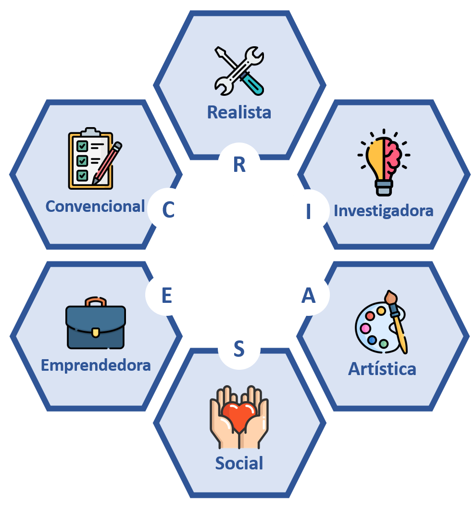
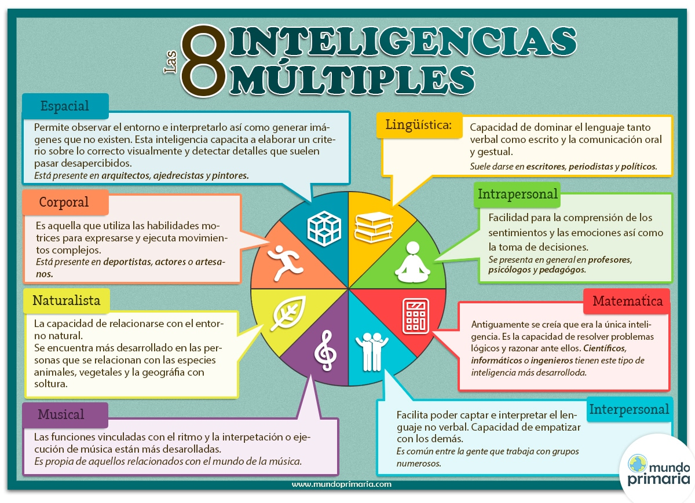

## No tengo ni idea qué estudiar... ¿Qué hago?

Elegir una carrera es complejo. Desde la presión familiar respecto a "*tenés que estudiar esto porque lo estudió tu abuelo, tu viejo, tu hno, etc...!*", "*es la empresa familiar y vas a continuarla vos*", "*si estudiaste esta modalidad en la secundaria, seguí con lo mismo en la facultad, si total, ya sabes del tema…*", o "*aquello es lo que te va a dar plata*", pasando por la perspectiva de que, por elegir una carrera, se cree que será la única por el resto de nuestras vidas... hasta llegar al punto de realmente no saber qué elegir por el simple hecho de desconocer qué se quiere, qué nos gusta, qué somos capaces de hacer...

El **propósito de este posteo** (*y por ende de todo el server*) es **ayudar a orientarlos** si se sienten así. Por eso, recomiendo **tomarse esta situación con seriedad pero, así también, con calma.** La mayoría de nosotros nos hemos encontrado en esta etapa. No será la primera ni la última vez, más aún para aquellos que todo el tiempo estamos buscando nuevo contenido y herramientas para aprender.

Entonces, sin más que decir, empecemos!

Esta charla también creció: ahora es la **Charla de carreras 2027**, diez paradas para entender cómo funciona la educación superior, qué títulos existen, cuándo te tenés que anotar y cómo elegir qué estudiar. Está pensada para 6to año de técnica, modalidad Informática, pero le sirve a cualquiera que esté por terminar la secundaria.

::vista{#taller-ciclosuperior img="previews/taller-ciclosuperior.webp" cta="Ver la charla"}

## ¿Cómo puedo saber qué me gustaría estudiar?

Cuando uno no está seguro de qué estudiar y/o de qué tipo de trabajo se ve haciendo en los próximos años, lo mejor es empezar a conocerse desde otra perspectiva. Acá es donde aparecen los **Test Vocacionales, de Personalidad y otros más**.

El **propósito de los Test Vocacionales o de Personalidad** es descubrir y reflexionar respecto a los intereses, gustos, habilidades y aptitudes de cada uno, y las tendencias que pueden existir hacia cierto ambiente académico. **Hay que demarcar que es una herramienta orientadora pero no determinante**. Es decir, proporciona data para evaluar las distintas variantes académicas que se adaptan a nuestro perfil, pero no se debe considerar como una respuesta final en lo absoluto al momento de elegir una carrera!

Cabe aclarar que **hacer un Test de Orientación Vocacional o de Personalidad tiene que ser tomado con seriedad y honestidad**. No hay que dudar en las respuestas. Y, si hay algo que no se sabe o no estas seguro, buscarlo en fuentes confiables de Internet.

Existen variados tipos de Test para hacer. En este posteo, **hablaré de tres de ellos**.

Recomiendo profundizar respecto a los más usados a través del [posteo de Psicólogos Córdoba](https://psicologoscordoba.org/test-orientacion-vocacional-mas-usados/).

:::callout{tipo="tip"}

Y recordá que porque "*no te gusta x materia*" **no tiene que ser un impedimento** para estudiar la carrera. En todas habrá asignaturas que no te van a gustar y presentarán obstáculos en la cursada. Así que, **si realmente te gusta y disfrutas** lo que estas haciendo, lo otro **no tiene por qué tirarte abajo**.

:::

### Test basado en el Código Holland

El Dr. John L. Holland, un psicólogo y profesor norteamericano de la universidad de Johns Hopkins, desarrolló, en la década de 1970, la teoría de que los géneros laborales podían clasificarse de la misma forma que los tipos de personalidad. Asimismo, combinarse de una manera que ayudara a las personas a descubrir aquellos puestos laborales donde más prosperarían. Desde entonces, se han realizado varias investigaciones que demuestran que la elección ocupacional es a menudo una expresión de la propia personalidad. Las mismas han confirmado su validez a través de las variadas culturas y géneros. Así, ha cambiado la forma en que funciona el desarrollo profesional.

En sí, la **Teoría de Holland se basa en seis tipos de personalidad** propuestos: **realista, investigadora, artística, social, emprendedora o convencional/detallista**. Juntos, estos tipos de personalidad crean el acrónimo **RIASEC**.

- **Realista**: Son pensadores prácticos que prefieren adoptar un enfoque realista para la resolución de problemas en lugar de utilizar la teoría. No les gusta perder el tiempo. Prefieren actuar sobre un problema en lugar de simplemente hablar sobre este.
- **Investigadores**: Son pensadores. Mientras que los tipos realistas prefieren actuar primero y pensar después, el tipo investigador prospera observando y considerando ideas antes de actuar sobre ellas.
- **Artístico**: Son creadores. Son autoexpresivos y no disfrutan de los límites de la estructura o las reglas. Piensan fuera de la caja y son muy emocionales.
- **Social**: Son ayudantes. Encuentran satisfacción al hacer conexiones y ayudar a los demás.
- **Emprendedores**: Son persuasivos. Realmente saben cómo "hablar lo que se habla" y saben lo que necesitan hacer para realizar un trabajo. Lograr que otros se unan a su visión es su mayor regalo.
- **Convencional**: Son organizadores. Viven según las reglas y la organización es la clave de su éxito. Suelen disfrutar trabajando con datos y realmente comprenden el arte del autocontrol.

:::callout{tipo="idea"}

Si buscas profundizar sobre el tema, te recomiendo el siguiente artículo

::recurso{#test-de-holland-articulo}

:::

:::callout{tipo="tip"}

Ejemplo de **Test de Holland**

::recurso{#test-holland-online}

:::

### Test de Personalidad Myers-Briggs

El indicador de tipo Myers-Briggs es una de las pruebas de personalidad reconocidas y autorizadas disponible en la comunidad de psicología y recursos humanos. **Evalúa el tipo de personalidad y explora opciones profesionales**.

Esta prueba clasifica a las personas en uno de los 16 tipos de personalidad diferentes. Con una serie de preguntas, la prueba determina si gravitas hacia la extroversión o la introversión, el sentido o la intuición, el pensamiento o el sentimiento y el juicio o la percepción.

Aquí hay una guía rápida para comprender las cuatro categorías dentro de la prueba Myers-Briggs:

- **Extroversión (E) o Introversión (I)**: se trata de cómo obtienes tus ganas/energía para hacer las cosas. ¿Buscas energía desde adentro o recurrís a fuentes externas?
- **Sentido (S) o intuición (N)**: Revela cómo percibís y absorbes la información. Las personas que obtienen un resultado S tienen más probabilidades de usar experiencias pasadas y el sentido común para evaluar situaciones, mientras que los que se centran en la intuición ven fácilmente el panorama general y los patrones.
- **Pensar (T) o Sentir (F)**: Con este rasgo de personalidad, se revela tu estilo de toma de decisiones. Los Pensadores se guían por la lógica y el sentido común, mientras que los Sensibles pueden confiar en los valores de los sentimientos. Para los tipos de sentimientos, el proceso de toma de decisiones puede estar guiado por cómo una decisión afectaría a los demás.
- **Juzgar (J) o Percibir (P)**: Revela preferencias de estilo de vida o cómo te gusta vivir la vida. Los tipos de Jueces están organizados y se sienten cómodos trabajando dentro de las reglas y el marco. Es más probable que los tipos Perceptores prefieran un entorno flexible, adaptando los planes según sea necesario.

Las preguntas de la prueba revelan si perteneces a la tipología ISTP (introversión, sentido, pensamiento, percepción), ENFJ (extroversión, intuición, sentimiento, juicio) o alguna de las otras 14 posibilidades.

:::callout{tipo="tip"}

Ejemplo de **Test de Myers-Briggs**

::recurso{#sakinorva}

::recurso{#16personalities}

:::

### Test de Inteligencias Múltiples de Howard Gardner

La teoría de las Inteligencias Múltiples fue presentada por primera vez en 1983 por el psicólogo Howard Gardner, cuando publicó su libro Frames of Mind. En este, declaró que el **aprendizaje ocurre a través de muchos tipos de inteligencias y que las personas tienen varios niveles de cada una. En síntesis**, la teoría establece que, **identificar el tipo de inteligencia de un estudiante permite seleccionar actividades apropiadas y guiar su viaje de aprendizaje de manera más efectiva**.

Entre los tipos de inteligencias se encuentran:

- **Inteligencia Corporal-Cinestésica**

La capacidad de manipular tanto el cuerpo como los objetos con un agudo sentido del tiempo. Estas personas pueden manipular objetos con precisión debido a una fuerte unión cuerpo-mente. Esto se puede demostrar en forma de habilidades físicas, por ejemplo, atletas y bailarines, o en movimientos precisos y constantes, como cirujanos y artesanos.

- **Inteligencia Existencial**

La habilidad de poder tener discusiones profundas sobre el significado de la vida y la existencia humana. Las personas con esta inteligencia son sensibles pero pueden abordar de manera racional preguntas difíciles, por ejemplo, cómo llegamos aquí y por qué todos finalmente mueren.

- **Inteligencia Interpersonal**

Si bien la capacidad de comunicarse eficazmente con los demás es de conocimiento común sobre la base de la inteligencia interpersonal, no se limita simplemente a las interacciones verbales. Las personas con inteligencia interpersonal desarrollada también pueden leer los estados de ánimo de los demás. La sensibilidad a los temperamentos y la capacidad de comunicarse de forma no verbal permiten a estos individuos comprender las diferencias en las perspectivas. Debido a que a menudo pueden evaluar con precisión los sentimientos y las motivaciones de los demás, estos individuos son buenos trabajadores sociales, maestros y actores.

- **Inteligencia Intrapersonal**

Refiere a la habilidad de comprender los propios pensamientos. Los individuos que demuestran inteligencia intrapersonal son muy conscientes de sus sentimientos y pueden mostrar aprecio por ellos mismos y por los demás seres humanos. A menudo mal interpretadas como "tímidas", estas personas en realidad se motivan a sí mismas y son capaces de usar su comprensión para dirigir el curso de sus propias vidas. Los filósofos, psicólogos y líderes religiosos pueden mostrar altos niveles de inteligencia intrapersonal.

- **Inteligencia Verbal-Lingüística**

La capacidad de expresarse utilizando palabras y lenguaje. Esta inteligencia es única porque es la habilidad humana más comúnmente compartida. Nos permite aplicar significado a las palabras y expresar aprecio por frases complejas. Al leer, escribir y compartir historias oralmente, podemos maravillarnos de nuestro uso del lenguaje. Vemos ejemplos de esta habilidad en periodistas, poetas y oradores públicos.

- **Inteligencia Lógico-Matemática**

A veces, malinterpretada como simplemente la capacidad de calcular ecuaciones matemáticas, la inteligencia lógico-matemática es mucho más que eso. Las personas con esta inteligencia desarrollada demuestran excelentes habilidades de razonamiento, pensamiento abstracto y la capacidad de inferir basándose en patrones. Son capaces de hacer conexiones basadas en sus conocimientos previos y se sienten atraídos por la categorización, los patrones y las relaciones entre ideas. Con los experimentos y los juegos de estrategia como dos actividades codiciadas, tendría sentido que las posibles carreras incluyan un científico, un matemático y un detective.

- **Inteligencia Musical-Rítmica**

Quienes poseen inteligencia musical demuestran la capacidad de reflexionar agudamente sobre los sonidos. Estas personas son capaces de distinguir entre tonos, tonos y ritmos específicos que otros pueden pasar por alto. Alguien con inteligencia musical suele ser un oyente sensible y puede reflejar o reproducir música con bastante precisión. Los músicos, directores, compositores y vocalistas demuestran una gran inteligencia musical. La inteligencia musical también está estrechamente relacionada con la inteligencia matemática, ya que comparten un proceso de pensamiento similar.

- **Inteligencia Naturalista**

La sensibilidad a las características del mundo natural está más estrechamente ligada a lo que se llama inteligencia naturalista. La capacidad de distinguir entre seres vivos y no vivos fue notablemente más valiosa en el pasado, cuando los humanos a menudo eran agricultores, cazadores o recolectores. Hoy en día, esta inteligencia ha evolucionado a roles más modernos, como chef o botánico. Todavía tenemos rastros de inteligencia naturalista, algunos más que otros, lo que es evidente por nuestras preferencias por ciertas marcas sobre otras.

- **Inteligencia Visual-Espacial**

Se sabe que las personas visualmente artísticas demuestran inteligencia espacial. Estas habilidades incluyen la manipulación de imágenes, habilidades gráficas y razonamiento espacial, cualquier cosa que incluya más de dos dimensiones. Pueden ser soñadores despiertos o les gusta dibujar en su tiempo libre, pero también muestran interés en acertijos o laberintos. Las carreras directamente vinculadas a la inteligencia espacial incluyen muchas vocaciones artísticas, por ejemplo, pintores, arquitectos o escultores, así como carreras que requieren la capacidad de visualizar, como pilotos o marineros.

Las 8 Inteligencias Múltiples (Fuente: Mundo Primaria)

:::callout{tipo="tip"}

Ejemplos de **Test de Inteligencias Múltiples de Howard Gardner**

::recurso{#test-inteligencias-uaeh}

::recurso{#test-inteligencias-idrlabs}

::recurso{#test-inteligencias-webuniversitaria}

:::

:::callout{tipo="tip"}

**A continuación, comparto algunos portales para chusmear**

::recurso{#test-no-se-que-estudiar}

::recurso{#test-vocacional-up}

::recurso{#orientacion-vocacional}

::recurso{#edumatch}

:::

:::callout{tipo="aviso"}

**Para profundizar!**

::recurso{#como-saber-que-carrera-estudiar}

:::

## Algo que recomiendo escuchar si todavía tenés dudas sobre dar el siguiente paso…

::video{id="wbAqmGC_nRw"}

---

## Conozco el ámbito donde me quiero desempeñar pero: ¿a qué tipo de titulación/institución de Nivel Superior apunto?

Para todos **aquellos que necesiten opciones y opiniones respecto a la elección de la titulación**, sea en educación formal/informal, cómo elegir a dónde ir, qué ofrecen (y qué tanto sirven) las facultades, cursos, bootcamp o YouTube, recomiendo ver el siguiente vídeo.

::video{id="rA1whJGg2ew"}

La charla es planteada por mi profesor de varios años en la carrera de docente en informática, [**Matías García**](https://www.youtube.com/c/profmatiasgarcia/). Si lo recomiendo, es porque lo vale. Sigan a [**sysarmy**](https://linktr.ee/sysarmy).

## Desarrollo de carrera profesional en IT: ¿Qué significa y cómo empezar?

::video{id="loeYxbA1JkU"}

::video{id="aBVBKArk8Sw"}

---

## ¿Cómo puedo buscar dónde estudiar?

:::callout{tipo="tip"}

El gobierno argentino cuenta con el sitio "**Quiero Estudiar**" con data respecto a becas, programas y beneficios que ayuden en el trayecto a los estudiantes del país.

::recurso{#quiero-estudiar}

:::

:::callout{tipo="tip"}

**NoSeQuéEstudiar** es una comunidad con guía gratuita, en español, sobre carreras y profesiones disponibles y actualizadas. Tiene un apartado dedicado a las carreras, otro a profesiones, dónde estudiar y una sección de orientación respecto a los puntos anteriores. Asimismo, tiene a disposición un test vocacional gratuito para aclarar dudas.

::recurso{#no-se-que-estudiar}

:::

:::callout{tipo="tip"}

**BuscoUniversidad** es un buscador de Carreras Universitarias, Técnicas, Posgrados, Cursos y Universidades de Argentina

::recurso{#buscouniversidad}

:::

---

## Consideración en la búsqueda de carreras en 10 ítems rápidos

1. Buscar la institución y su perfil a nivel nacional
2. Investigar la carrera en cuanto a opiniones de estudiantes y egresados.
3. Ver número de Resolución (Ministerio de Educación y CONEAU)
4. Certificación / Título (y si tiene titulación intermedia)
5. Plan de estudios >> Correlatividades y Equivalencias
6. Horarios de cursada
7. Perfil del Egresado
8. Gratuita / Paga
9. Convenio con empresas para realizar prácticas
10. Convenio en el exterior

---

## ¿Cómo verificar si la institución/carrera/título existe realmente en Argentina? (y no es un baiteo terrible...)

:::callout{tipo="tip"}

**Buscador de Títulos Universitarios**: Base de titulaciones con reconocimiento oficial y su consecuente validez nacional otorgadas por el Ministerio de Educación de la Nación.

::recurso{#base-de-titulos-universitarios}

:::

:::callout{tipo="tip"}

**Buscador de Carreras de Pregrado y Grado**: Base de datos para la búsqueda de títulos de pregrado y grado según su modalidad, área de conocimiento, disciplina, gestión y nombre institucional, provincia y localidad (solo para la República Argentina)

::recurso{#guia-de-carreras-universitarias}

:::

:::callout{tipo="tip"}

**¿Buscas BECAS para ir a estudiar en el exterior? Campus Global** es una iniciativa que **promueve la movilidad internacional de estudiantes, docentes, investigadores** **en el exterior y extranjeros en la Argentina**. La plataforma cuenta con geolocalización, filtros y suscripciones para ajustar las búsquedas. ****

::recurso{#campus-argentina-global}

:::

:::callout{tipo="tip"}

Listado de Universidades en Argentina, tanto de gestión Estatal como Privada, ordenadas por Provincia (by Altillo)

::recurso{#universidades-de-argentina}

:::

---

## Para los que se sientan llamados al área de Seguridad Informática

::recurso{#security-certification-roadmap}

---

## Para los que se sientan llamados al área de programación

:::callout{tipo="idea"}

Antes de iniciar: si te interesa el mundo del desarrollo en general, pero no sabes para dónde ir, te recomiendo acceder al siguiente post de [@sysarmy](https://twitter.com/sysarmy) donde comparten charlas y materiales para aquellos que quieran iniciarse en la programación y necesiten guía.

::recurso{#sysarmy-hello-world}

:::

::recurso{#mujeres-en-tecnologia}

::video{id="PQsuIKwvDO4"}

