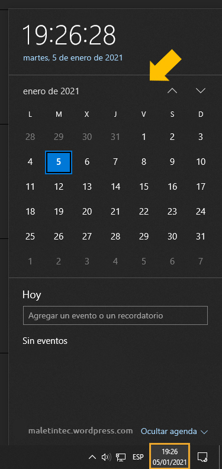
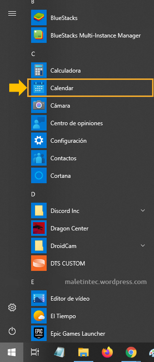
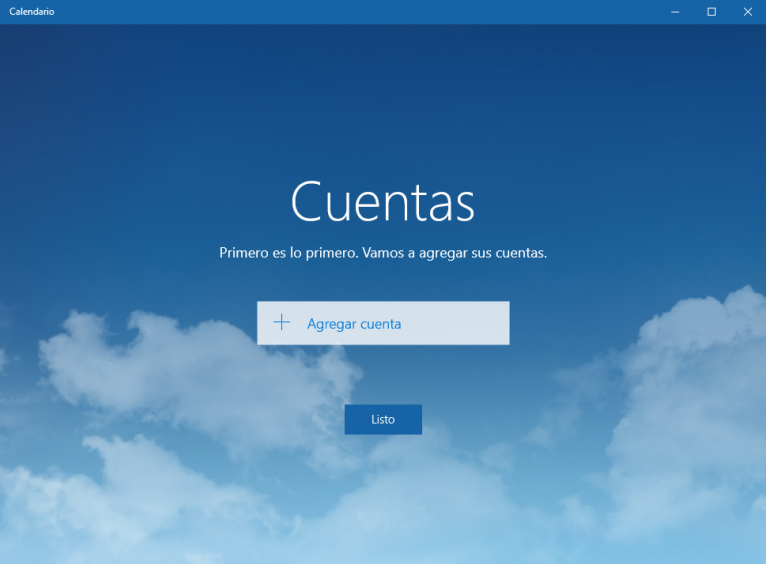
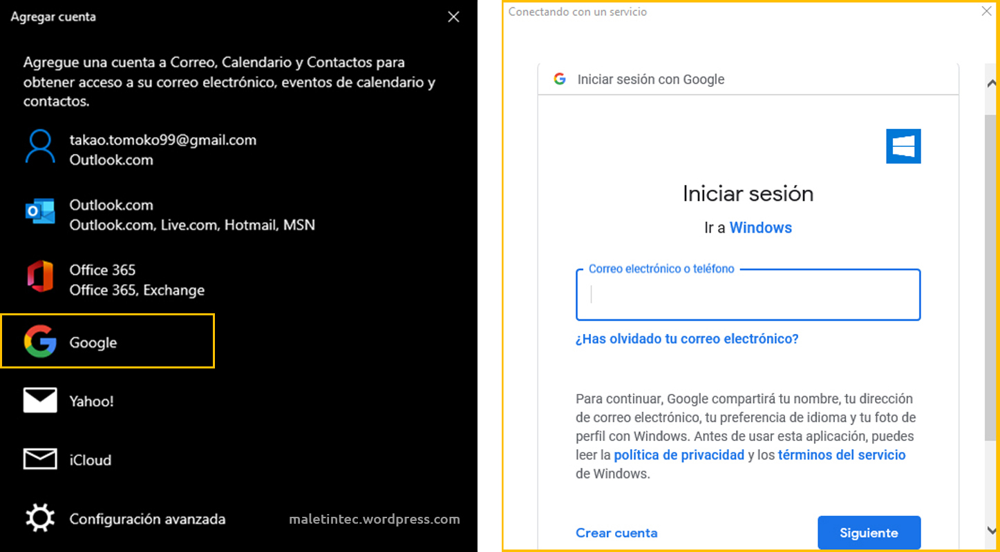
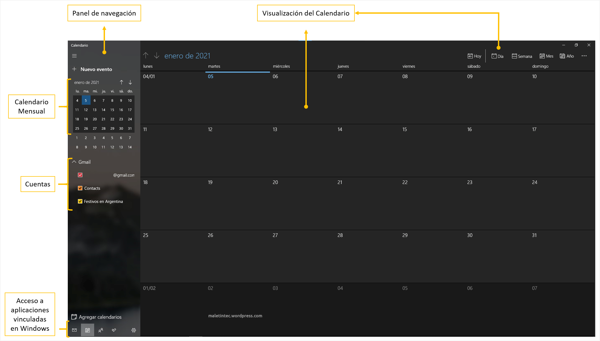
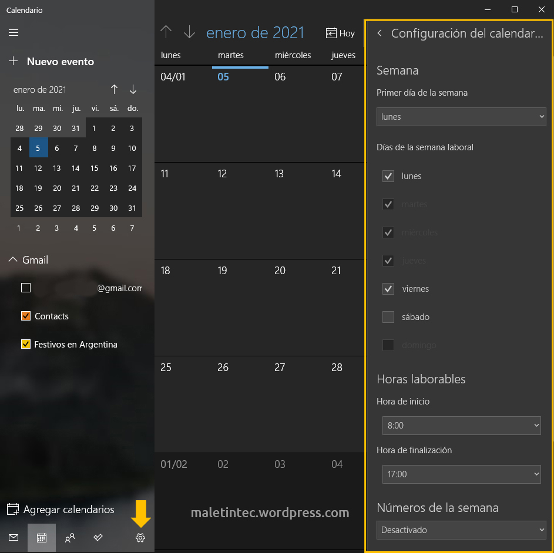
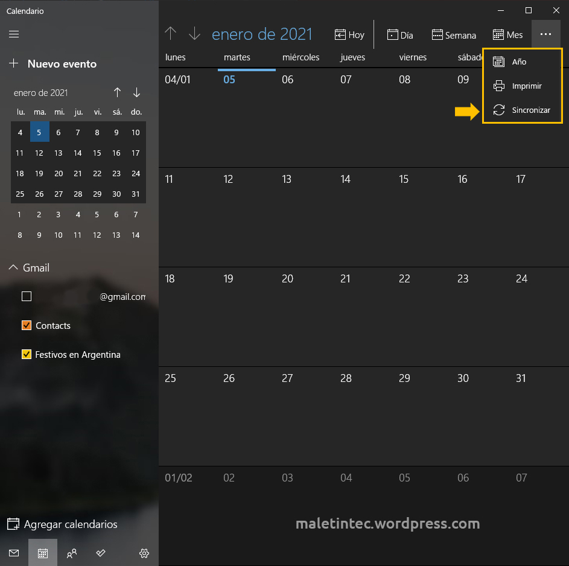
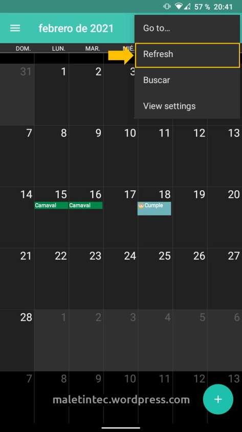

Sin importar si sos ingresante de una carrera, estudiante en formación, docente, o te desempeñas en otra área totalmente desligada a la educación, ser capaz de organizarse, concentrarse y llevar a cabo tareas pendientes son habilidades imprescindibles cuando se trata de administrar el trabajo y las actividades diarias.

Particularmente en el área educativa y laboral, la introducción y utilización de las Tecnologías de la Información y la Comunicación han provocado cambios evidentes en las formas de planificar la rutina. Más aún con el estado de pandemia debido al Covid-19 el cual provocó, desde marzo del 2020 para Argentina, un cambio total en la educación: mutar las clases presenciales a virtuales.

Estudiar de forma online o remota trae cierta flexibilidad en contraposición con las limitaciones del aula física. Lo cual permite programar el tiempo de estudio en torno a otros compromisos, sean familiares, laborales o personales, todo desde el hogar. Pero la comodidad y flexibilidad que presenta, deja un abanico de opciones sobre cuándo, dónde y cómo estudiar.

Por tanto, este post estará centrado en las **formas en que podes organizarte eficientemente** para llevar a cabo tus cursadas… *sin morir en el intento*.

## Elaborar una agenda, calendario u horario

Sea mediante un calendario online o una agenda tradicional, las herramientas de planificación permiten llevar un seguimiento de todos aquellos compromisos y/o actividades que se tenga a futuro. Básicamente, a crear y mantener una rutina.

Asimismo, evitan colmar la memoria de fechas y detalles que, a medida que pase el tiempo, terminarán olvidados, resultando en un problema mayor. Es decir, facilitan la priorización. Al tener toda la información plasmada en un solo lugar de acceso visual y rápido, es posible juzgar cuánto tiempo se tiene disponible, además de determinar qué tareas y/o reuniones son necesarios cumplir con mayor prioridad que otros.

Pero, no por menos importante, ayudan a programar descansos. Profundizado por la pandemia, las actividades educativas y laborales virtuales han presentado cambios en la organización temporal de cada persona, llevando a trabajar en horas no adecuadas para la salud corporal y mental. Por tanto, cuidar la salud en estas épocas es primordial.

Si sos de las personas que emplean la tecnología al 100% o queres comenzar a sacar beneficio de tus dispositivos, te recomiendo utilizar el Calendario integrado en tu equipo. Entre ellos se encuentran, iCal (para usuarios Apple), Google Calendar, Calendarios de Microsoft (como Outlook o aquel integrado en Windows 10).

En esta oportunidad, te muestro **cómo configurar el Calendario de Windows 10** para que se encuentre **sincronizado a Google Calendar**, y todos tus dispositivos que utilicen cuenta Google.

### El Calendario de Windows 10: Configuración y sincronización

Microsoft Windows cuenta con aplicaciones para la organización, tan simples como la hora y fecha, desde sus inicios. Sin embargo, a lo largo de sus entregas, se ha adecuado a las necesidades de sus usuarios. Uno de esos cambios ha sido la aparición del Calendario (o Calendar). Su particularidad está dada en la capacidad de **agrupar, en un solo sitio, cualquier evento existente en todas las cuentas de correo pertenecientes al usuario**. Tan solo será necesario conexión a Internet para mantener sincronizados los cambios que sucedan en el mismo.

Por defecto, el Calendario se encuentra integrado en el ícono que muestra la fecha y hora, en la parte inferior derecha de la barra de tareas del escritorio.

También podés acceder desde el menú Inicio > Calendar.

La primera vez que se ejecuta la aplicación, se mostrará una ventana a modo de bienvenida. A continuación, se pedirá ingresar una cuenta para sincronizar el Calendario. Aunque también es posible añadir otras más adelante.

En este caso, seleccionar Google.

Una vez iniciada la sesión y aceptados los permisos de seguridad que pide el propio sistema, la aplicación tomará unos segundos para sincronizar toda la información de la cuenta. De esa forma, estará lista para usar.

Por supuesto, es posible vincular otros correos, modos de visualizar eventos, fechas, entre otros.

Para que se **vinculen los cambios realizados** en el **Calendario desde Windows 10**, tan solo es necesario **hacer clic en “Sincronizar”**.

En cambio, para que se **vinculen los cambios realizados en Google Calendar**, solo hay que **hacer clic en “Refresh” (actualizar)**.

**A modo de aclaración**: **No siempre es necesario aplicar la “sincronización”** en ambas plataformas para visualizar la nueva información. Mayormente, si la **conexión a Internet es de buena calidad**, la **actualización de datos se hace automáticamente** al abrir cada aplicación.

## Crear y organizar un espacio de trabajo dedicado

Es importante **asegurar que el espacio donde se trabajará sea cómodo y adecuado**. Es decir, **que sea ergonómico**.

Hablar de **Ergonomía** es referirse a dos cuestiones. Por un lado, la Asociación Internacional de Ergonomía habla de un conjunto de conocimientos científicos los cuales se aplican para que sistemas, productos, trabajos y ambientes se adapten a todas aquellas capacidades y limitaciones, tanto físicas como mentales, de una persona.

Por el otro, la Asociación Española de Ergonomía refiere al conjunto de conocimientos multidisciplinares aplicados a la adecuación de sistemas, productos y entornos artificiales a todas aquellas necesidades, limitaciones y características de los usuarios. Ello en pos de optimizar la seguridad, eficacia y bienestar de cada uno. [1]

Entonces, al momento de evaluar el lugar donde se trabajará, es necesario **verificar cada uno de los objetos involucrados que afectarán a la persona**. Por ejemplo, tanto la mesa como la silla deben permitir una buena postura y, al estar sentado, la parte superior del escritorio debe descansar entre el pecho y la caja torácica. De esa forma, podrás apoyar los codos en el escritorio sin tener que inclinar los hombros hacia adelante. Asimismo, la silla debe ser cómoda, ajustarse a la altura del escritorio y permitir que los pies descansen sobre el suelo.

Particularmente sobre esta cuestión, **pasar muchas horas sentado y en la misma posición llevará a molestias** (o inclusive dolores) en la zona lumbar. Por lo que, es recomendable, levantarse y caminar por la casa cada media hora.

Otro punto importante es establecer, en la medida de lo posible, un **horario de trabajo**. Es decir que, las personas con las que se conviva en el hogar, sepan en qué horarios sería beneficioso no distraer.

[1] Asociación Española de Ergonomía. (s.f.). *¿Qué es la ergonomía?*. [Acceder aquí](http://www.ergonomos.es/ergonomia.php).

## Anticiparse al cronograma

Si bien puede no perjudicar esperar hasta el último momento para hacer una tarea el día antes de la fecha límite, sería provechoso intentar **completar las actividades con anticipación** (siempre y cuando se cuente con el tiempo). Esto permitiría una **mayor flexibilidad de los horarios libres**.

Idealmente, las asignaciones deberían terminarse un par de días antes de la fecha de entrega final. De esa manera, tendrías días para verificar nuevamente el práctico a entregar. Inclusive disminuir el nivel de estrés al saber que, si surge algo, lo importante ya estará terminado.

## Reunir todo el material, ¡y hacer back up siempre!

**Recolectar apuntes, análisis, material de lectura**, mapas y cuadros permitirá a**cceder a las mismas en cualquier momento de necesidad**. Además de agilizar los tiempos de búsqueda en caso de requerirlo al estar en medio de una clase.

Ahora bien, **los fallos de la tecnología no se toman vacaciones**, mucho menos en tiempos de necesidad. Por tanto, **intentá guardar regularmente en alguna unidad extraíble o almacenamiento online**, todos aquellos materiales que encuentres y generes. Asimismo, cuando los almacenes, sería beneficioso **organizarlos por asignatura, fechas y propósito**. Simplemente crea recordatorios a través de notas (como dejar un documento de texto dentro de la carpeta de los archivos), cambia el nombre del fichero donde tengas tus datos, etc.
