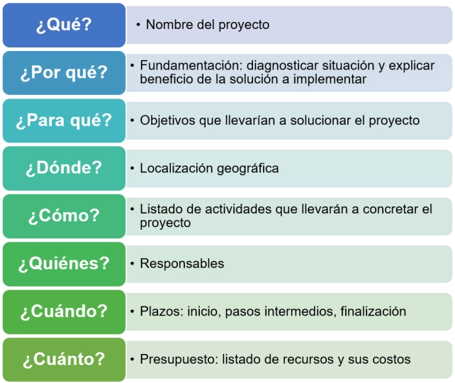

Un **proyecto** consiste en un conjunto de tareas a realizar de forma articulada, con la finalidad de generar determinados servicios o bienes que permitan satisfacer o resolver necesidades. Esto debe cumplirse dentro de ciertos límites presupuestarios y de tiempo pautados. [1]

Al momento de transformar una idea en proyecto, se deben considerar una serie de preguntas que permitirán guiar el desarrollo del mismo [2] [3]:

## Etapas

Se inicia con la elaboración de un **diagnóstico** para fundamentar el proyecto a realizar, identificando claramente las problemáticas existentes de un grupo o comunidad, pensar sus posibles causas y plantear aquellos sobres los cuales se trabajará.

En segundo lugar, la **planificación** para desarrollar la idea y así transformarla. Para este apartado hay que considerar, en primera instancia, la identificación del objetivo (*¿para qué?*) además de los beneficiarios y el planteamiento del producto final. Esto debe hacerse de manera realista, clara y medible, con metas a corto plazo para poder llegar a la resolución final. Los propósitos deberán plantearse desde lo general a lo particular, es decir un objetivo general a varios específicos con los resultados esperados.

Seguidamente, detallar todas las actividades que se llevarán a cabo, pensando en los objetivos marcados en el punto anterior. Las mismas deben ser ubicadas en el tiempo mediante la confección de un cronograma.

Finalmente, plantear un listado de todos los recursos necesarios y cotizarlos. Particularmente, dividirlos según: recursos humanos, materiales, financieros, etc.

En tercer lugar, la **ejecución**, correspondiendo a la puesta en marcha del proyecto siguiendo las tareas planteadas previamente.

Como última etapa queda la **evaluación**, siendo fundamental para lograr aprendizaje mediante la reflexión de todos los miembros participantes, enfocándose en los sucesos acontecidos a lo largo de todo el proyecto.

## Estructura general

El siguiente esquema es solamente a modo de guía. Puede alterarse en caso de necesidad o según autor (como Ander-Egg [3]):

- Carátula
- Institución (con o sin logo)
- Título del proyecto
- Autores
- Fecha de entrega
- Índice de contenido
- Aspectos generales
- Justificación del proyecto
- Objetivos
- Generales
- Específicos
- Limitaciones del proyecto
- Suposiciones
- Restricciones
- Producto final (*que se creará*)
- Beneficios del proyecto (*y beneficiarios*)
- Metodologías y recursos (*incluye localización, presupuestos, etc*.)
- Cronograma de actividades
- Desarrollo
- Conclusiones
- Recomendaciones
- Anexo

---

## Referencias

[1] Programa de Apoyo a la Docencia, Investigación y Difusión de las Artes. (2014). *Guía PADID: ¿Qué es un proyecto?* [Archivo PDF].

[2] Fundación UPM (s.f*.). Guía para la formulación de proyectos*. [Archivo PDF] [Acceder aquí](https://www.upm.uy/siteassets/documents/guia-para-la-formulacion-de-proyectos.pdf).

[3] Aguilar Idáñez, M.J., Ander-Egg, E. (1997). *Cómo elaborar un proyecto. Guía para diseñar proyectos sociales y culturales*. Lumen/Humanitas. [Acceder aquí](https://www.researchgate.net/publication/31701510_Como_elaborar_un_proyecto_guia_para_disenar_proyectos_sociales_y_culturales).
