Hablar de **Procesadores de Texto** es referirse a los programas dedicados a la creación, edición y procesamiento de documentos textuales con formato. Brindan un gran conjunto de funcionalidades, ya sean tipográficas, organizativas, semánticas, estéticas.

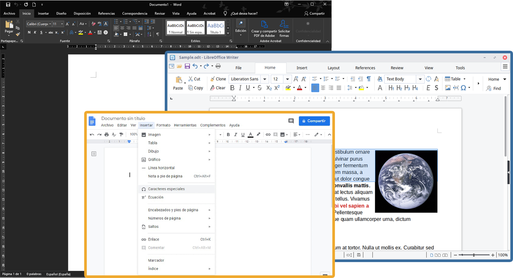

*Procesadores de Texto (de izq. a der.: Microsoft Office: Word, Google Docs, LibreOffice Writer)*

## Aplicaciones disponibles para el usuario

En el mercado actual es posible encontrarlos ya sea en formato offline como online. Generalmente, cuentan con la mayoría de las herramientas para trabajar, aunque con diferente nombre y ubicación dentro de la plataforma. Por ello **es necesario conocer la utilidad de cada una de las funciones, logrando independencia a la hora de trabajar con cualquiera de las aplicaciones disponibles**. A continuación, se presentan algunas alternativas.

### Microsoft Office: Word

:::media

Comúnmente conocido como **Word**, es un programa para el desarrollo de textos, perteneciente a la suite Microsoft Office. Es necesario adquirir el software (para la versión de escritorio) o contar con una cuenta a través del sitio web de Microsoft. Si deseas acceder a este, puedes [ingresar aquí](https://www.microsoft.com/en-us/microsoft-365/word).
:::

### Google Docs

:::media
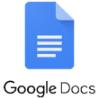

Sin dudas, uno de los más conocidos es **Docs**, aplicación perteneciente a la suite de Google para la creación y edición de documentos. El mismo permite trabajo colaborativo entre usuarios con cuenta Gmail. Si estás interesado, puedes [acceder aquí](https://www.google.com/intl/es_AR/docs/about/).
:::

Asimismo, si existen dudas sobre las herramientas que presenta esta plataforma o precisas más información, el Gobierno de la Ciudad de Buenos Aires ha publicado un [documento a modo de tutorial](https://biblioteca-digital.bue.edu.ar/descargar/90df29-tutorial-google-docs-documentos.pdf), dentro del Plan Integral de Educación Digital, Colección de aplicaciones gratuitas para contextos educativos.

### LibreOffice: Writer

:::media
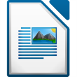

Si es necesario un procesador de texto para escritorio, y no se desea pagar por una versión privada, otra recomendación es **Writer**, programa integrado en la suite LibreOffice. Similar a Microsoft Word, tiene como finalidad crear documentos de texto (pero de forma libre y gratuita). Si deseas probarlo, puedes [ingresar aquí](https://www.libreoffice.org/).
:::

Además, en caso de necesitarlo, te comparto una [**guía completa** sobre **Writer**](https://wiki.documentfoundation.org/images/5/53/WG60-Gu%C3%ADadeWriterLO.pdf), elaborada por [LibreOffice Documentation Team](https://documentation.libreoffice.org/es/documentacion-en-espanol/).

## Partes que conforman un desarrollo textual profesional

Para **propósitos de este posteo**, se utilizará el entorno gráfico de Microsoft Word. Sin embargo, ¡se abordarán otros entornos a futuro!

Asimismo, el **objetivo de la siguiente información** es **orientar** a cualquier usuario que necesite **desarrollar un documento de texto**. Cada uno de los ítems que se expliquen a continuación, son **aplicables en un contexto general**. Se **abordará** cada **sección, su propósito y cómo armarlo** de manera simple.

*¡Ojalá sea de ayuda!*

### Portada

**Ocupa** la **primera** **hoja** del trabajo. **No debe llevar encabezado ni pie de página**, por lo que para eso se debe configurar de la siguiente forma (ver Figura 1):

1. Doble clic en la parte superior de la hoja donde se posicionaría el encabezado o en la parte inferior para el pie de página (en cualquiera de las dos partes se aplicará la configuración).
2. Luego, en la **pestaña especial Diseño** (de *Herramientas para Encabezado y Pie de página*), **marcar** la opción **Primera página diferente** del **apartado** **Opciones**.

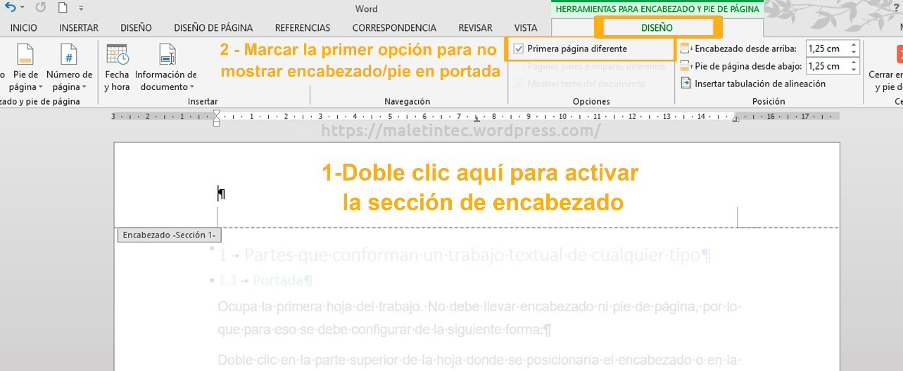

*Figura 1: Configuración de encabezado y pie al utilizar una portada*

Normalmente (a menos que se indiquen pautas particulares), **se indica**:

- Institución (con o sin logo)
- Título
- Destinatario (puede indicarse la asignatura con o sin el apellido del docente)
- Autores
- Fecha de entrega

Asimismo, es posible emplear las portadas autogeneradas por Microsoft Office desde la **pestaña Insertar**, haciendo clic en el **ícono Portada** del **apartado Páginas** (ver Figura 2).

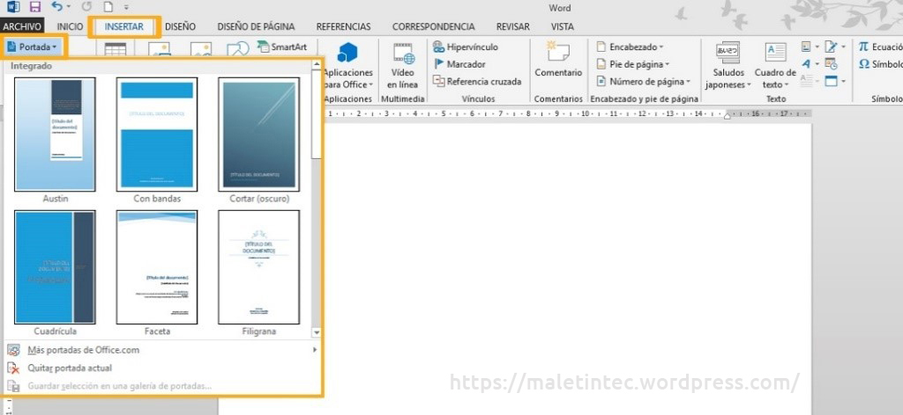

*Figura 2: Empleo de portadas prediseñadas en Microsoft Word*

### Título

Al momento de tener que escribir el título, este debe ser **preciso, claro y completo**, **refiriéndose** a la **temática** a tratar en el **texto**.

### Encabezado

A menos que se den pautas previas, **se aplica desde la página 2** (es decir, desde aquella que no lleva portada) y normalmente se indica:

- **Lado izquierdo**: Asignatura
- **Lado derecho**: Institución educativa o Institución en la cual se presentará.

Asimismo, el tamaño de la fuente debe ser menor al del cuerpo del trabajo. Por ejemplo:

- **Cuerpo**: Arial 11
- **Encabezado de página**: Arial 9

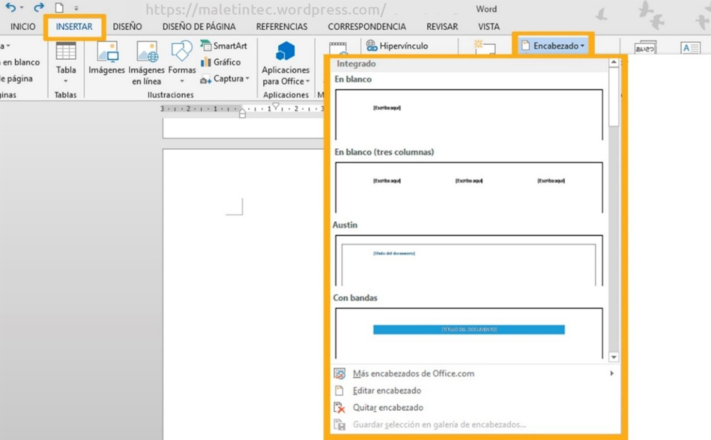

*Figura 3: Configuración de encabezado*

### Pie de página

Al igual que en el encabezado, **se aplica desde la página 2** (es decir, desde aquella que no lleva portada) y si no existen pautas previas, se indica:

- **Lado izquierdo**: Autores
- **Lado derecho**: Número de página

El tamaño de la fuente debe ser menor al del cuerpo del trabajo. Por ejemplo:

- **Cuerpo**: Arial 11
- **Pie de página**: Arial 9

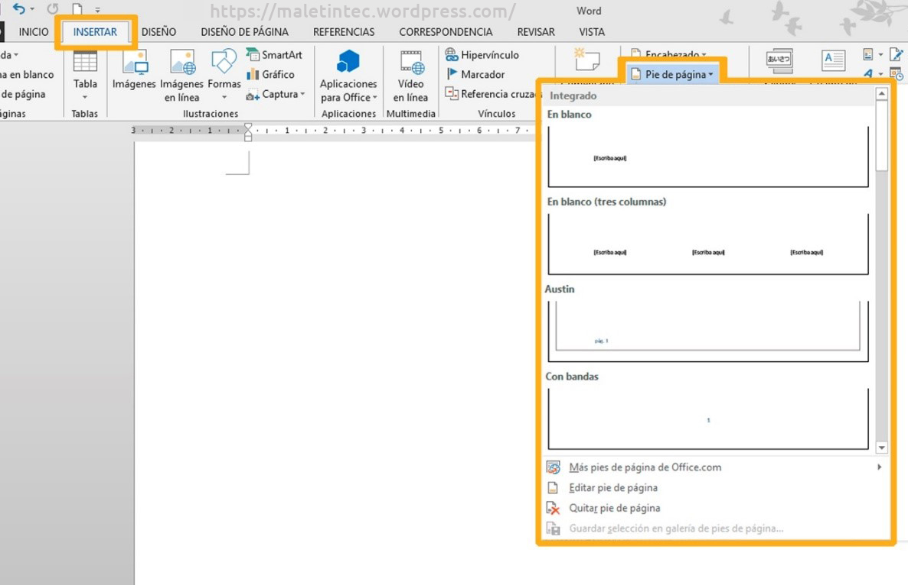

*Figura 4: Configuración pie de página*

### Tabla o Índice de contenido (de Título y de Figuras/Imágenes o Tablas)

**Colocado en la página 2** (la siguiente a la portada), permite que cualquier lector conozca los temas que se tratarán en el texto. Asimismo, como autores, permite tener conciencia del esquema/jerarquización de nuestro desarrollo. Pueden existir tres tipos:

#### De títulos

**Únicamente** se **muestran** los **títulos** que conforman el documento. Los mismos son **aplicados mediante los estilos pre diseñados para estos**.

Para aplicar el estilo a los títulos, se **accede** desde la **solapa Inicio**, **apartado** **Estilos** (ver Figura 5).

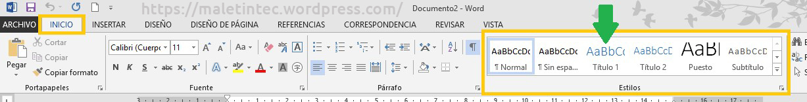

*Figura 5: Ubicación estilos*

Para **insertar** un índice de títulos, ir a la **solapa Referencias**, **apartado Tabla de Contenido**. A continuación, **hacer clic en Tabla de Contenido Personalizada**. En la ventana que se abrirá, **indicar** en la sección general, **Formato Estilo Elegante**. Además, **Mostrar Niveles** con **mínimo** de **5** (ver Figura 6).

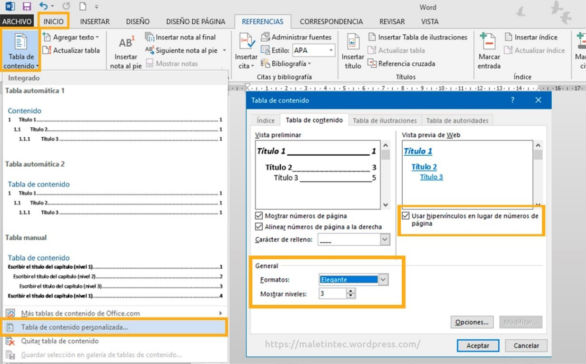

*Figura 6: Insertar y configurar una tabla de contenido*

#### De figuras/imágenes o tablas

Empleado para **visualizar** los **títulos** de las **etiquetas** aplicadas tanto a **figuras**, **imágenes** o **tablas** (ver Figura 7).

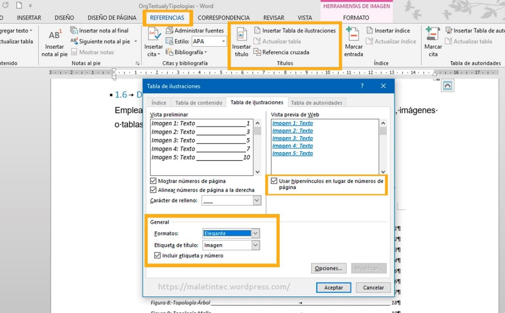

*Figura 7: Insertar y configurar tabla de ilustraciones/tablas*

### Introducción

Tiene como **finalidad** **contextualizar** el **texto** **que se presentará**, **mediante** una **idea breve y cerrada**. **No describe** los **aspectos** en sí, sino que los **menciona** en **breves palabras**, **explicando** la **finalidad** y la **importancia** del trabajo. No debe desarrollar el tema ni explicar las conclusiones, sino **aludir a la explicación del porqué del trabajo, sus objetivos, criterios de análisis**, etc. Suele funcionar como justificación cuando no existe dicho apartado en nuestra elaboración.

Algunas **preguntas** que se pueden **considerar** a la hora de **redactar** la **introducción** (son a modo de guía, recordar no responderlas como tales, sino emplearlas para el desarrollo textual):

- ¿Cuál es el tema elegido?
- ¿Por qué se realiza dicho trabajo?
- ¿Qué metodología se emplea?
- ¿Qué cuestiones fueron abarcadas?
- ¿Qué limitaciones existieron?

En caso de tratarse de la **introducción** de un **proyecto**, considerar además:

- Explicar las maneras en las que el proyecto buscará solucionar un problema planteado y su contribución > Finalidad (¿Por qué se lleva a cabo el proyecto?)
- Impacto en el tiempo (corto, mediano y/o largo plazo)
- Beneficios que planteará
- Interés, utilidad y novedad que presenta el proyecto

### Justificación

Exponer todas aquellas razones que den importancia y motiven a realizar el trabajo. **En caso de no especificarse, suele** estar **planteado en la introducción.**

Se emplea el marco teórico para dar formalidad en caso de que no exista un apartado particular para ello.

### Cuerpo

**Parte principal** y más extensa, la cual no puede faltar ya que nos referimos al desarrollo de trabajo en sí. Tiene como **finalidad** la **exposición** de la investigación o **temática pedida**.

#### Inserción de títulos en objetos [etiquetas]

Permiten **identificar** el **contenido** de **imágenes, figuras, tablas** **para** luego **referenciarlas** en una **tabla/índice del mismo tipo**. Para cada uno de ellos, existe un tipo específico que se selecciona en la lista desplegable referente al rótulo (ver Figura 8). El mismo se compone de un título (el rótulo identificatorio), el número del objeto. Asimismo, se puede agregar una descripción de referencia.

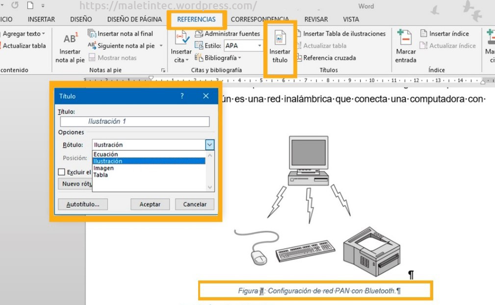

*Figura 8: Insertar título en objetos (imágenes, tablas)*

#### Referencia cruzada

Permite **vincular** tanto los **títulos de los objetos** como **otras partes** del mismo documento. El mismo aparece como un vínculo que lleva al lector al elemento al que se hace referencia.

Para generar una referencia cruzada es necesario que exista aquello que queremos asociar. Luego, será necesario ir al apartado **Referencias > Referencia cruzada**.

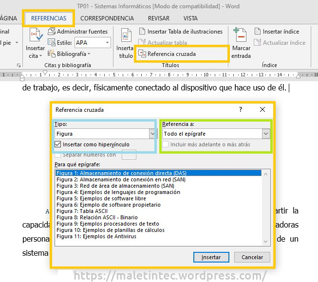

*Figura 9: Insertar referencia cruzada en texto*

Aparecerá una ventana como la que se visualiza en la Figura 9, compuesta de las siguientes opciones:

- **Tipo**: desde la lista desplegable elegir aquello que se desea vincular. Los elementos que están disponibles dependerán del tipo de elemento que será vinculado.

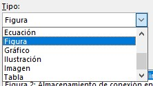

- **Referencia a**: seleccionar aquí la información que desea insertar en el documento, ya sea solo el rótulo y número, el epígrafe completo, entre otros.

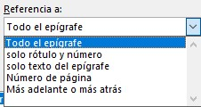

- **Insertar como hipervínculo**: esto permitirá ir al elemento al que se hace referencia con tan solo hacer clic.

### Notas al pie

Permiten **indicar** **aclaraciones** **particulares** **o bibliografía** sobre una palabra, párrafo o sección particular del texto. Solo es **necesario** **seleccionar** **lo que** **necesitemos** **referenciar**, para luego **ir** a la **solapa Referencias** y hacer **clic** en **Insertar nota al pie** (ver Figura 10).

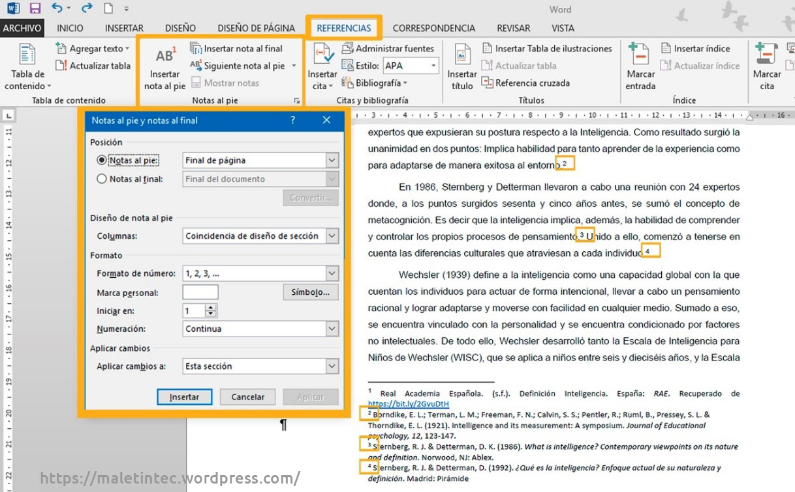

*Figura 10: Insertar y configurar notas al pie de página*

### Conclusión

Es una síntesis, una interpretación final del trabajo. Se encuentra en directa **relación** con lo propuesto o evidenciado en la introducción y el desarrollo textual, nombrando los **puntos/ideas que se abordaron** e **integrando el análisis final** (la conclusión en sí) a modo de cierre coherente.

### Bibliografía

Proporciona **información** **sobre** las **fuentes empleadas**, además de **proveer** **credibilidad** al **trabajo realizado**. Se debe llevar a cabo un correcto uso tanto de las citas como de las referencias bibliográficas en sí, **aplicando** alguna de las **normativas** existentes para ello como **APA**, **IEEE** (si necesitas información podes acceder a [ieee.es](https://www.ieee.es/Galerias/fichero/Varios/1-Normas_Presentacion_Originales_IEEE.pdf) o al [posteo de la Biblioteca de la Univ. de Málaga](https://biblioguias.uma.es/citasybibliografia/IEEE)), ICONTEC, etc. Deben **ordenarse** de **modo** **alfabético**.

#### Normativa APA

Básicamente es un **conjunto** de **estándares** o **reglas** que **permiten** **facilitar** la **comprensión** de la **lectura** de un **texto** **formal** en el que se hace referencia a otros autores, documentos, sitios, etc.

Debido a la variedad de reglas que existen dependiendo el formato de texto que precisemos citar, **hay** algunos **sitios** que nos **permiten** **acceder** a ellos mediante una búsqueda rápida.

- [Sitio de la **Normativa APA**](https://normas-apa.org/citas/cita-textual/)
- [Documento en PDF con **modos y ejemplos de aplicación**](https://normas-apa.org/wp-content/uploads/Guia-Normas-APA-7ma-edicion.pdf)

Si, por ejemplo, necesitamos saber cómo referenciar un libro, bastaría con indicarlo de la siguiente forma “citar libro normas APA-org” (ver Figura 11).

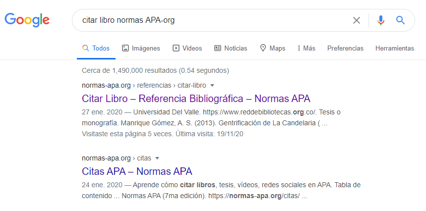

*Figura 11: Búsqueda para citar un libro según normas APA*

O si fuera el caso de querer conocer cómo citar un video de YouTube, tan solo será necesario escribir en Google: “citar video YouTube normas apa-org” (ver Figura 12).

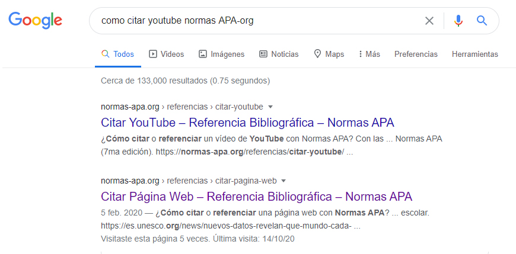

*Figura 12: Búsqueda para citar un video de YouTube según normas APA*

### Anexo o Apéndice

**Sección independiente** que permite **anexar** **material** que se referencia en el texto o que **permitirá** una **mejor** **comprensión** sobre **aspectos** **específicos** tratados. Por ejemplo, gráficos, figuras, infografías, tablas, encuestas, etc.

## Configuraciones particulares

### Fuente en Títulos y Cuerpo Textual

Para la **realización** de **trabajos** **académicos** es **recomendable** **emplear** **fuentes legibles** **no** **cursivas**. Dependiendo del texto al que se aplique la fuente, será necesario seguir cierto estándar.

#### Títulos

Al momento de aplicar la fuente a los **títulos**, es posible hacerlo de dos maneras:

1. De **forma manual**:
- **Fuente**: Arial / Times New Roman / Tahoma
- **Tamaño**: 16pts (o superior dependiendo de dónde se ubique el título, ya sea una portada o la parte superior de un informe)
2. De **forma automática**: aquellos a los que se les aplica los estilos pre definidos (explicado en el apartado [*Índice o Tabla de Contenido > De títulos*](https://maletintec.wordpress.com/2021/01/04/documentos-academicos-como-disenarlos-adecuadamente/#indice-de-contenido-de-titulos))

#### Cuerpo textual

Al mismo es posible aplicar tres tipos de fuentes y tamaños recomendados:

- **Fuente** Arial, con un **tamaño** de 11pts.
- **Fuente** Times New Roman, con un **tamaño** de 12pts.
- **Fuente** Tahoma, con un **tamaño** de 12pts.

### Párrafos

A la hora de **organizar el cuerpo de un texto**, se debe **considerar** tanto **sangría** como **interlineado** y **espaciado**. Estos tres aspectos dan una apariencia más limpia, clara y ordenada al texto que presentaremos.

### Sangrías

Conceptualmente refiere a la **separación** d**el párrafo con respecto al margen izquierdo o derecho del documento**. Puede utilizarse en párrafos o pequeños grupos de texto. **Existen cuatro tipos**, que pueden ubicarse en la regla que se encuentra en la parte superior de la página (ver Figura 13).

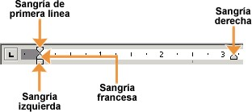

*Figura 13: Ubicación de los tipos de sangría en la regla*

#### Sangría a la Izquierda

Aquella con la que podemos marcar la separación de **todas las líneas** de un **párrafo** con **respecto** al **margen izquierdo** del texto.

Se aplica desde la **pestaña Inicio**, apartado **Párrafo**. Se abrirá una ventana donde, en la **sección Sangría**, marcaremos la **opción Izquierda** (ver Figura 14).

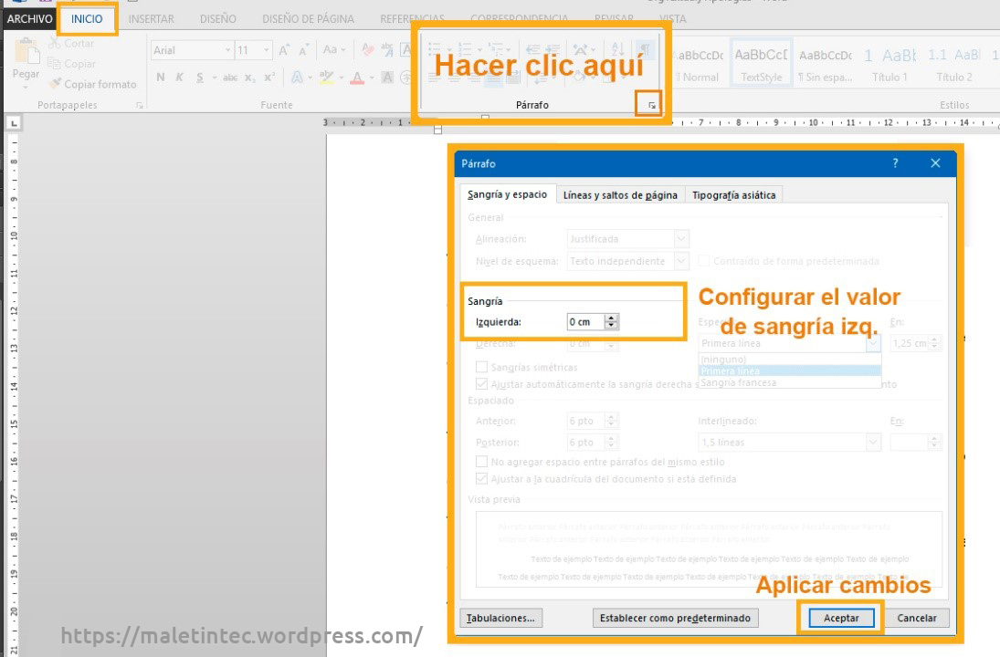

*Figura 14: Configuración de la sangría izquierda*

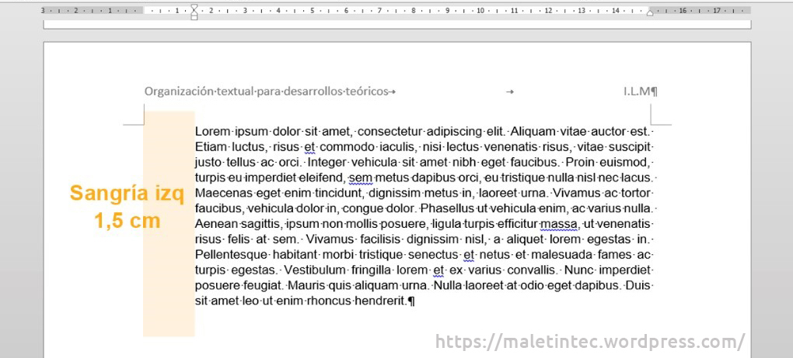

*Figura 15: Ejemplo de aplicación de la sangría izquierda*

#### Sangría a la Derecha

Al igual que con la anterior, marca la separación de **todas las líneas** de un **párrafo** con **respecto** al **margen derecho** del texto.

Se aplica desde la **pestaña Inicio**, apartado **Párrafo**. Se abrirá una ventana donde, en la **sección Sangría**, marcaremos la **opción Derecha** (ver Figura 16).

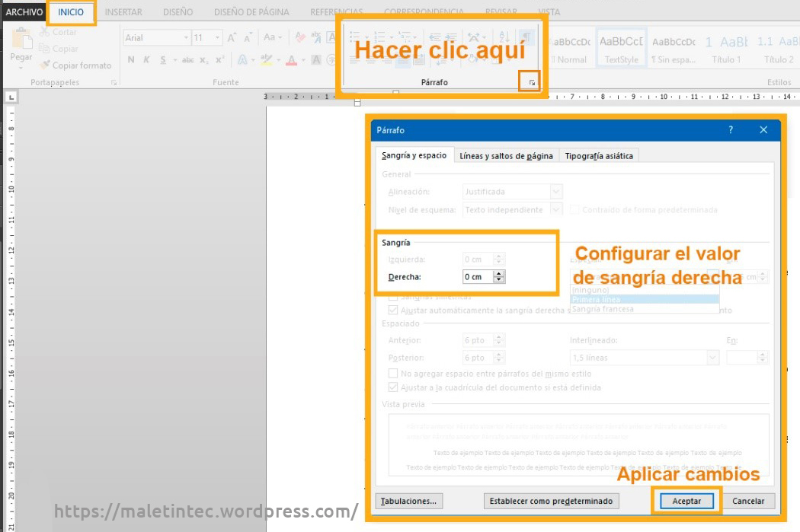

*Figura 16: Configuración de la sangría derecha*

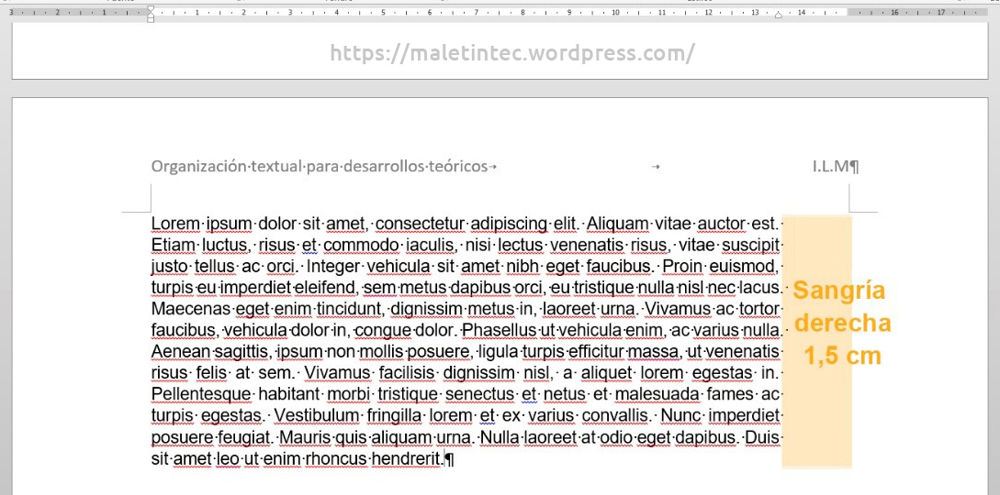

*Figura 17: Ejemplo de aplicación de la sangría derecha*

#### Sangría de Primera Línea

La opción más utilizada en textos. Permite asignar **sangría únicamente a la primera línea del párrafo**.

Se aplica desde la **pestaña Inicio**, apartado **Párrafo**. Se abrirá una ventana donde, en la **sección Sangría, Especial**, marcaremos la **opción Primera línea** (ver Figura 18).

*Figura 18: Configuración de la sangría especial de primera línea*

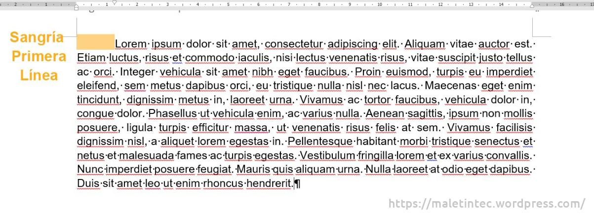

*Figura 19: Ejemplo de aplicación de la sangría especial de primera línea*

#### Sangría Francesa

Funciona al revés de la primera línea. Tipo de sangría donde la **primera línea (del párrafo) aparece más a la izquierda que el resto** del párrafo seleccionado. Empleado en numeraciones.

Se aplica desde la **pestaña Inicio**, apartado **Párrafo**. Se abrirá una ventana donde, en la **sección Sangría, Especial**, marcaremos la **opción Francesa** (ver Figura 20).

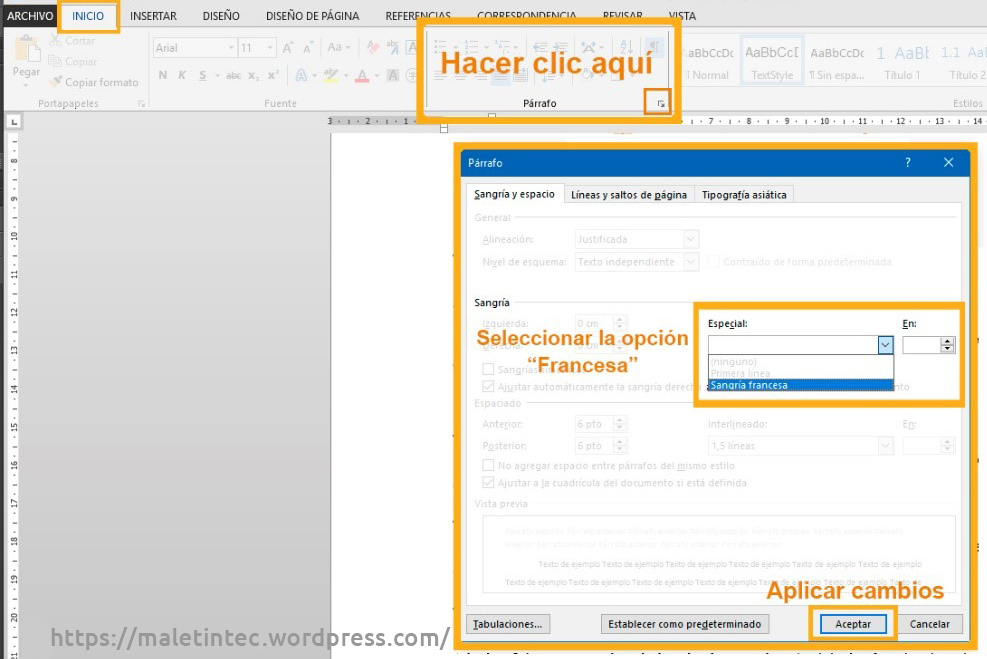

*Figura 20: Configuración de la sangría especial francesa*

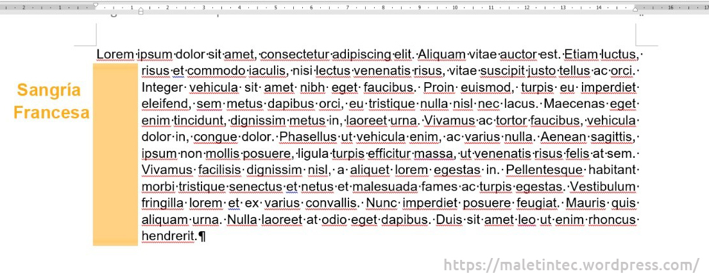

*Figura 21: Ejemplo de aplicación de la sangría especial francesa*

### Espaciado entre líneas: Interlineado

Refiere a la **cantidad de espacio entre las líneas del texto (párrafo)**. Word tiene predefinido el interlineado en *sencillo*. Sin embargo, **dependiendo** del **tipo** de desarrollo **textual** que estemos realizando, **corresponde** un **determinado** **interlineado**. A continuación, el **listado de los tipos de interlineados** disponibles:

- **Sencillo**: Utilizado en modo predeterminado por el procesador de textos (pj, Word)
- **1,5 líneas**: Deja una distancia de 1,5 líneas por cada renglón.
- **Doble**: Es aquel que tiene una distancia de 2 líneas (deja un renglón libre entre cada línea de escritura)
- **Mínimo**: Posee una medida predeterminada de 12 puntos (incrementable de 1 en 1)
- **Exacto**: Es similar al anterior.
- **Múltiple**: Tiene como valor predeterminado 3 puntos y al incrementarlo aumenta en 0,5 puntos.

Si no existe pauta previa, es recomendable **setear el interlineado en 1,5 líneas**. Para aplicarlo, hay que ir a la **pestaña Inicio**, apartado **Párrafo**. Se abrirá una ventana donde, en la **sección Espaciado**, marcar la **opción Interlineado 1,5 líneas** (ver Figura 22).

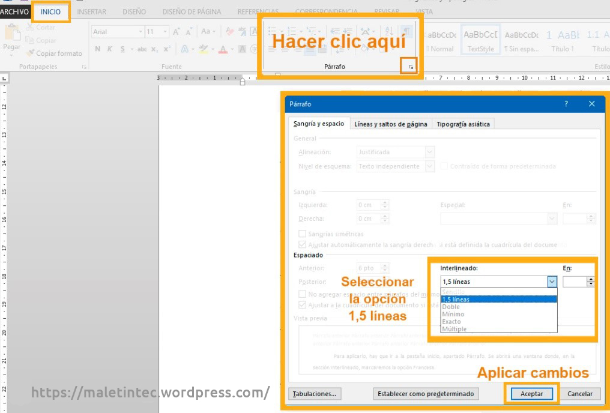

*Figura 22: Configuración del interlineado de 1,5 líneas*

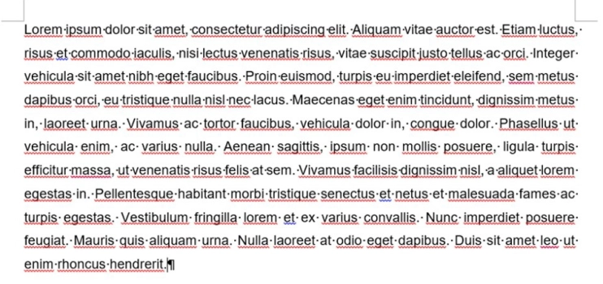

*Figura 23: Ejemplo de aplicación del interlineado de 1,5 líneas*

### Espaciado entre párrafos

Refiere al espacio entre un párrafo y otro. Si no existe pauta previa, es recomendable **setear el Espaciado en 6pts Anterior y Posterior**.

Para aplicarlo, hay que ir a la **pestaña Inicio**, apartado **Párrafo**. Se abrirá una ventana donde, en la **sección Espaciado**, colocaremos los valores correspondientes (ver Figura 24).

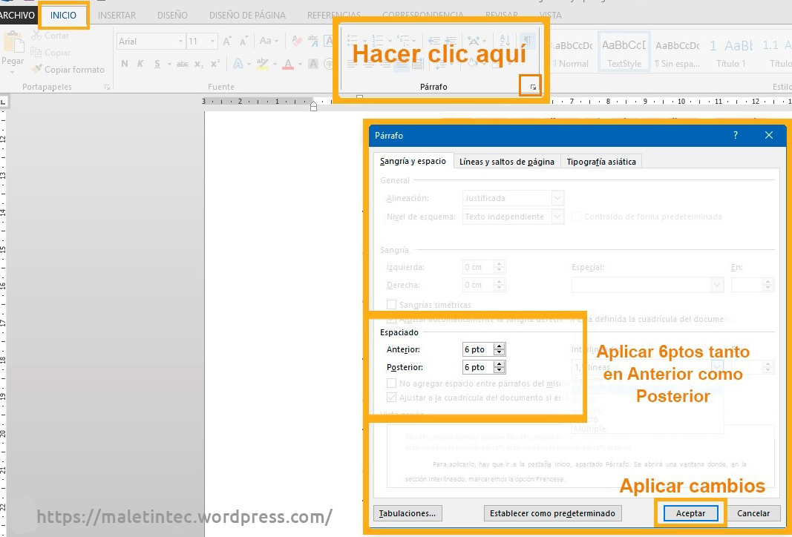

*Figura 24: Configuración del espaciado anterior y posterior*

### Creación de estilos

Los estilos permiten no solo dar formato a todo un documento (o parte de este), sino también a crear luego los índices de contenido.

Para **crear un estilo**, tan solo basta con ir a la **pestaña Inicio**, **apartado Estilos**. Hacer clic en el **ícono de la parte inferior derecha** (ver Figura 25). Luego, seleccionar el **ícono de Crear Estilo**. Se abrirá una **ventana** donde deberemos **configurar** tanto la **fuente** **como** el **formato de párrafo** (sangría, espaciado e interlineado) (ver Figura 26).

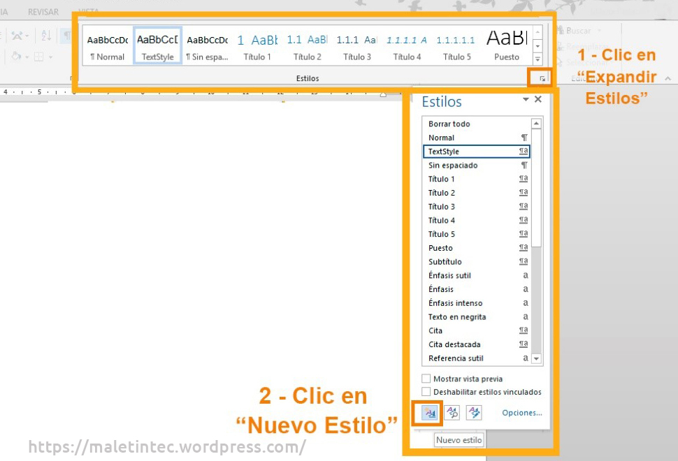

*Figura 25: Creación de estilos*

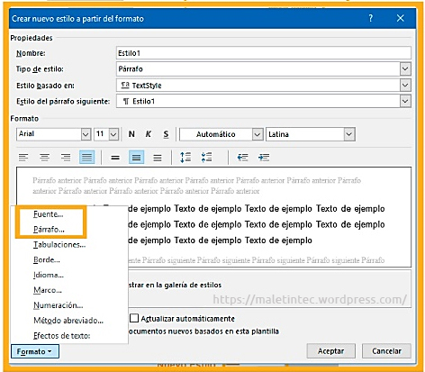

*Figura 26: Creación de un nuevo estilo a partir de un formato*

Por si todavía existen dudas, el siguiente esquema puede ayudar a comprender mejor.

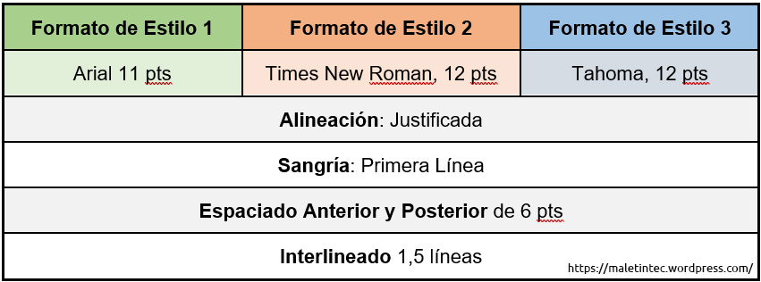

*Ejemplos con formatos de estilo útiles*

### Organización de objetos

Tanto los **cuadros como las imágenes**, formas, gráficos **tienen** una **posición** en la hoja con **respecto al texto**. Esta es **posible configurarla seleccionando el objeto**, y luego en la **pestaña** de **Formato** que se generará automáticamente en la parte superior, hacer **clic** en la **opción necesaria**.

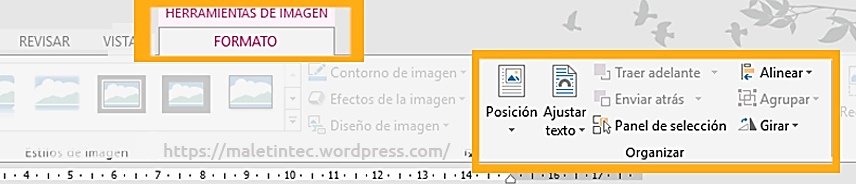

*Figura 27: Organización de objetos*

#### Posición

Permite **ubicar** un **objeto** seleccionado en la **página**. El **texto se ajustará** automáticamente **alrededor** del objeto para que siga siendo fácil leerlo. Por ejemplo, al crear un artículo se quiere ubicar una imagen en el centro de la hoja. Por tanto, se seleccionaría la opción **Posición**, **Centro**.

#### Ajustar texto

Elige el **modo en que el texto se ajusta al objeto seleccionado**. Por ejemplo, puede seleccionar que el texto continúe alrededor del objeto o lo cruce directamente.

### Diseño de Página: Márgenes y Orientación

**Existen** **diferentes modos de configurar** la hoja de trabajo: márgenes, orientación, tamaño, columnas.

#### Márgenes

**Establece los tamaños de margen de todo el documento o de una sección** particular. Es posible emplear los predefinidos según tamaño de hoja o personalizar uno en caso particular ya sea desde el ícono de Márgenes o desde la regla ubicada en la parte superior de la hoja de trabajo (ver Figura 28)

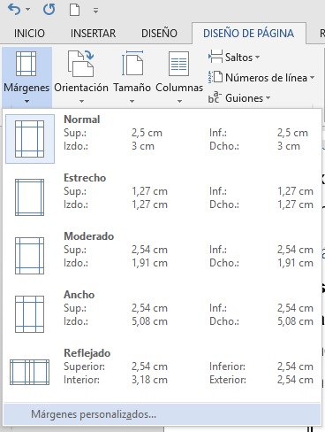

*Figura 28: Tipos de márgenes*

#### Orientación

Puede ser **vertical u horizontal** dependiendo la necesidad. Se aplica desde el apartado **Diseño de Página > Orientación**.

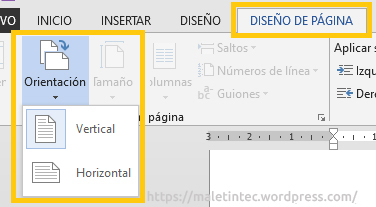

*Figura 29: Orientación de página*

### Saltos de página

Existen situaciones en las que se hace necesario organizar el texto de manera tal que la información presentada no se vea interrumpida de modo brusco. Para evitar eso, es imprescindible el uso de los saltos de página. Dependiendo la necesidad, Word ofrece distintos tipos (ver Figura 30).

Por ejemplo, **en caso que se quieran ordenar cuadros** para evitar que queden desglosados entre una página y otra, lo **conveniente sería emplear un salto de página común**, en donde marca el punto en que termina una hoja y comienza la siguiente.

Ahora bien, **en caso de que se necesite tener una página con orientación horizontal en medio del document**o, lo **conveniente** sería **aplicar tanto en página anterior como posterior un salto de página siguiente**. De esta forma crearíamos tres secciones: la primera con orientación de hoja vertical, la segunda sección con orientación horizontal (para ubicar la información necesaria en la misma), y una tercera sección para retomar la orientación vertical del trabajo.

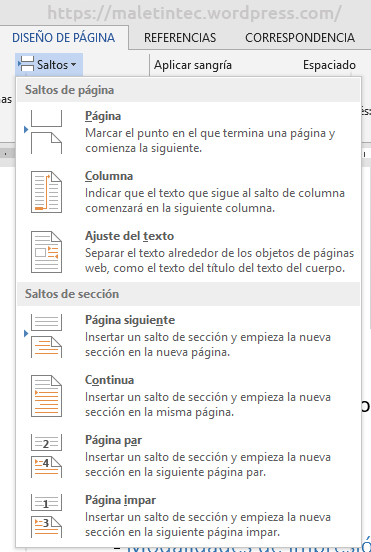

*Figura 30: Tipos de saltos de página y sección*

### Nombramiento de archivos para la entrega

Al momento de enviar cualquier tipo de archivo, sería conveniente pautar reglas para mantener uniformidad en las recepciones y posterior corrección de los trabajos.

El nombramiento podría estar dado por el curso, apellido/s los integrantes, y el título del documento, finalizando con la extensión del archivo correspondiente. Por ejemplo: [5IA]_Apellido_TP01.doc; 5IA_Apellido_TP01.doc.

## Ejemplo de un documento armado

::recurso{#ejemplo-guia-para-tp}
