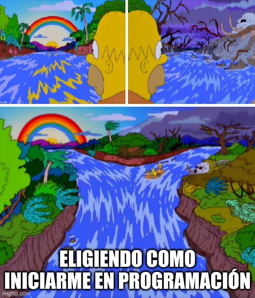
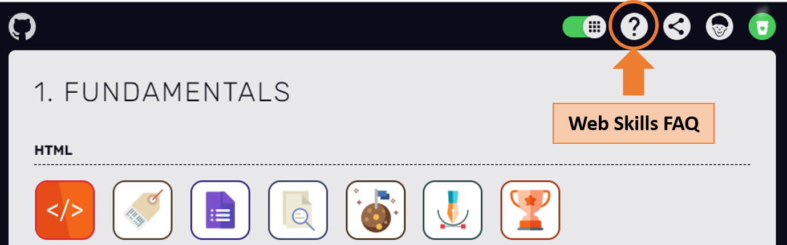

:::callout{tipo="aviso"}

Antes de iniciar: si te interesa el mundo del desarrollo en general, pero no sabes para dónde ir, te recomiendo acceder al siguiente post de [@sysarmy](https://twitter.com/sysarmy).
Ahí comparten charlas y materiales para aquellos que quieran iniciarse en la programación y necesiten guía.

::recurso{#sysarmy-hello-world}

:::

- [Hilo de @profmatiasg en X](https://twitter.com/profmatiasg/status/1463936582113796096)
- [Hilo de @DamianCatanzaro en X](https://twitter.com/DamianCatanzaro/status/1462086208830328839)
- [Hilo de @zamarrowski en X](https://twitter.com/zamarrowski/status/1463821542341718019)

---

## Si querés enfocarte en el área de Desarrollo Web, recomiendo que primero accedas a Web Skills

::::callout{tipo="idea"}

**Web Skills** es un **panel visual general de todas aquellas habilidades útiles para aprender como desarrollador web**. Es interesante y de utilidad para las personas que acaban de empezar a aprender sobre esta temática y para las personas que han estado en el campo durante años y quieren aprender cosas nuevas.
Como principiante, **te recomiendo que no veas este sitio web como la lista definitiva** de lo que se necesita saber, **sino como un ejemplo de lo que podés aprender y por dónde empezar**.
Las **habilidades están organizadas en orden cronológico según la ruta de aprendizaje que te recomiendo que sigas**, pero siéntete libre de *saltar* libremente. *(by Andreas)*

:::callout{tipo="idea"}

Recomendación: Leer **Web Skills FAQ** para comprender mejor cómo funciona el sitio.

::recurso{#web-skills}

:::

::::

:::callout{tipo="idea"}

**The Data School** explica diversas temáticas orientadas al **manejo de datos**

::recurso{#data-school-dashboards}

:::

:::callout{tipo="idea"}

Fundamentals of Data Visualization by Claus O. Wilke

::recurso{#fundamentals-of-data-visualization}

:::

:::callout{tipo="idea"}

The Manager's Handbook by Alex MacCaw

::recurso{#the-manager-s-handbook}

:::

---

## Desarrollo en HTML5 y CSS3

:::callout{tipo="idea"}

**George Moller** es un desarrollador y creador de contenido dedicado a CSS, HTML, JS & UI/UX**.**

::recurso{#george-moller-html-css-slides}

:::

- [Hilo de @_georgemoller en X](https://twitter.com/_georgemoller/status/1459538965741158401)
- [Hilo de @_georgemoller en X](https://twitter.com/_georgemoller/status/1457730300860108812)

:::callout{tipo="idea"}

**CSS Layout y Transition.css** son **repositorios de diseños y patrones** populares hechos con CSS.

::recurso{#transition-css}

:::

:::callout{tipo="idea"}

**Layout patterns** es una **colección de patrones de diseño** creados con API de CSS que ayudan a crear interfaces comunes como tarjetas, dynamic grid areas y diseños de página completa.

::recurso{#web-dev-layout-patterns}

:::

:::callout{tipo="idea"}

**Super Designer** es una **colección de herramientas de diseño web**. Abarca variados tipos de generadores: pattern, shades, colors, shape, blob & gradient.

::recurso{#super-designer}

:::

:::callout{tipo="idea"}

**Landing Page** es una **biblioteca completa de recursos para crear landing pages** de alta calidad.

::recurso{#landing-page-checklist}

:::

:::callout{tipo="idea"}

**Illustrationkit** ofrece **ilustraciones vectoriales gratuitas** para proyectos personales y comerciales.

::recurso{#illustration-kit}

:::

:::callout{tipo="idea"}

**Unicorn icons** ofrece **íconos animados** para utilizar en proyectos de uso personal con atribución.

::recurso{#unicorn-icons}

:::

:::callout{tipo="idea"}

**3dicons** ofrece una **colección de iconos 3D de código abierto** diseñados para utilizar en proyectos.

::recurso{#3dicons}

:::

:::callout{tipo="idea"}

**Hayk An, *design & code*** es una plataforma dedicada al diseño y desarrollo modular.

::recurso{#hayk-an}

::recurso{#hayk-an-generative-tools}

::recurso{#shaper}

:::

:::callout{tipo="idea"}

**Mesh** es una forma sencilla de crear degradados utilizando sombreadores WebGL.

::recurso{#mesh-gradient}

:::

:::callout{tipo="idea"}

C**olorpalettes.colorion.co** es un sitio que **ofrece más de 30 paletas de colores** seleccionadas para visualizar en one-page.

::recurso{#actionable-color-palettes}

:::

:::callout{tipo="idea"}

**Pratham** es un desarrollador y creador de contenido en [**Twitter**](https://twitter.com/Prathkum). Tiene múltiples hilos dedicados a **CSS y Responsive Web Design**.

:::

- [Hilo de @Prathkum en X](https://twitter.com/Prathkum/status/1377871173875335170)
- [Hilo de @Prathkum en X](https://twitter.com/Prathkum/status/1378618845225746433)
- [Hilo de @Prathkum en X](https://twitter.com/Prathkum/status/1379881164912099334)
- [Hilo de @Prathkum en X](https://twitter.com/Prathkum/status/1366278875467153413)
- [Hilo de @Prathkum en X](https://twitter.com/Prathkum/status/1380834198039171073)
- [Hilo de @Prathkum en X](https://twitter.com/Prathkum/status/1374652212928987137)
- [Hilo de @Prathkum en X](https://twitter.com/Prathkum/status/1396924726895955977?s=20)
- [Hilo de @Prathkum en X](https://twitter.com/Prathkum/status/1362686461544439809)
- [Hilo de @Prathkum en X](https://twitter.com/Prathkum/status/1363063942994685952)
- [Hilo de @Prathkum en X](https://twitter.com/Prathkum/status/1364142557052219394)

:::callout{tipo="idea"}

**HTMHell** es una **colección de malas prácticas en HTML**, copiadas de sitios web reales, **y cómo solucionarlos**.

::recurso{#htmhell}

:::

:::callout{tipo="idea"}

**CSSHell** es una **colección de errores comunes de CSS y cómo solucionarlos**.

::recurso{#css-hell}

:::

:::callout{tipo="idea"}

**CSS-Tricks** es un sitio dedicado a **artículos y guías sobre diferentes utilidades de CSS**.

::recurso{#css-tricks}

:::

---

## Diseño UX y UI

:::callout{tipo="idea"}

A Beginner’s Guide to Finding User Needs: Investigación cualitativa sobre motivaciones, actividades y problemas de los usuarios. By Jan Dittrich

::recurso{#finding-user-needs}

:::

:::callout{tipo="idea"}

**George Moller** es un **desarrollador y creador de contenido dedicado a CSS, HTML, JS & UI/UX.**

::recurso{#george-moller-ui-ux-slides}

- [Hilo de @_georgemoller en X](https://twitter.com/_georgemoller/status/1462441172006322176)

:::

:::callout{tipo="idea"}

**Web Vitals patterns** es una **colección de patrones UX** comunes optimizados para Core Web Vitals. Estas últimas son un conjunto de métricas de Google que analizan la UX de un sitio web. ( [**+ info**](https://web.dev/i18n/es/vitals/))

::recurso{#web-dev-web-vitals-patterns}

:::

:::callout{tipo="idea"}

**Freddy Montes ([@fmontes](https://twitter.com/fmontes)) es Frontend Developer y Diseñador UI.** En su cuenta de Twitter comparte contenido sobre el tema. Además cuenta con un ebook gratuito sobre Web Development.

- [Hilo de @fmontes en X](https://twitter.com/fmontes/status/1462779469509246985)

:::

:::callout{tipo="idea"}

**Radymag Design Almanac** es un **proyecto educativo que cubre los fundamentos del diseño: tipografía, cuadrícula, color y animación**.

::recurso{#readymag-design-almanac}

:::

:::callout{tipo="idea"}

Butterick’s Practical Typography, 2nd Edition

::recurso{#practical-typography}

:::

---

## Desarrollo y diseño web (variado)

:::callout{tipo="idea"}

**W3School** es un **sitio web dedicado al aprendizaje de lenguajes de programación**. Incluye tutoriales de HTML, CSS, JS, SQL, PHP, Python, Bootstrap, C, C++, C#, entre otros.

::recurso{#w3schools}

:::

:::callout{tipo="idea"}

**CSS Author** es un blog relacionado con el diseño y el desarrollo para diseñadores y desarrolladores web. **Ofrece recursos de diseño PSD gratuitos**, inspiraciones diarias de diseño, **artículos, resúmenes, tutoriales** y las últimas tendencias y técnicas web.

::recurso{#css-author}

:::

:::callout{tipo="idea"}

**CSS Author**, en su **apartado de Coding**, cuenta con artículos sobre **CSS, HTML, JS, JQuery, PHP, Bootstrap y Development Tools**.

::recurso{#css-author-coding}

:::

:::callout{tipo="idea"}

**DEVHINTS.IO**, creado por [**@rstacruz**](https://twitter.com/rstacruz), es una **colección de cheatsheets** de diversos **lenguajes orientados a desarrollo web**.

::recurso{#devhints}

:::

:::callout{tipo="idea"}

**CodePen** es un **entorno de desarrollo** social para diseñadores y desarrolladores Front-end. **Permite escribir código en el navegador y ver los resultados a medida que se construye**. Asimismo, mostrar un proyecto elaborado, crear casos de prueba para aprender, depurar código, etc. **Enfocado principalmente en lenguajes Front-end como HTML, CSS, JavaScript** y sintaxis de preprocesamiento.

::recurso{#codepen}

:::

:::callout{tipo="idea"}

**Frontend Practice** y **Codewell** son plataformas que cuentan con una **colección de sitios web reales para que los desarrolladores los recreen como una forma de mejorar y probar sus habilidades**.

::recurso{#frontend-practice}

:::

:::callout{tipo="idea"}

**CSSBattle** es un **juego de codificación de CSS en línea**. La idea, como jugador, es intentar replicar visualmente las figuras en código CSS y desarrollar dichas habilidades.

::recurso{#cssbattle}

:::

:::callout{tipo="idea"}

**Write the Docs** es una **comunidad global de personas que se preocupan por la documentación**. Cuentan con una comunidad de Slack, realizan conferencias en 3 continentes y reuniones locales.
**Tienen un posteo dedicado a guiar en el proceso de armado de documentación. Lo recomiendo!**

::recurso{#write-the-docs}

::recurso{#write-the-docs-guia}

:::

:::callout{tipo="tip"}

**Si estas metido en JS...**

- [Hilo de @alexanyernas en X](https://twitter.com/alexanyernas/status/1460993937452191748?ref_src=twsrc^tfw|twcamp^tweetembed|twterm^1460993937452191748|twgr^|twcon^s1_&ref_url=notion://www.notion.so/lourtech/Herramientas-para-Desarrollo-Web-ca0cc4a553714ff08ea9718cf5da716a)
- [Hilo de @junaidshaikh_js en X](https://twitter.com/junaidshaikh_js/status/1458401806527045636?ref_src=twsrc^tfw|twcamp^tweetembed|twterm^1458401806527045636|twgr^|twcon^s1_&ref_url=notion://www.notion.so/lourtech/Herramientas-para-Desarrollo-Web-ca0cc4a553714ff08ea9718cf5da716a)

:::

::::callout{tipo="tip"}

**Si estas metido en SQL...**

:::callout{tipo="idea"}

**SQLBolt** ofrece una serie de lecciones y ejercicios interactivos diseñados para ayudarte a aprender rápidamente SQL directamente en tu navegador.

::recurso{#sqlbolt}

:::

::::
