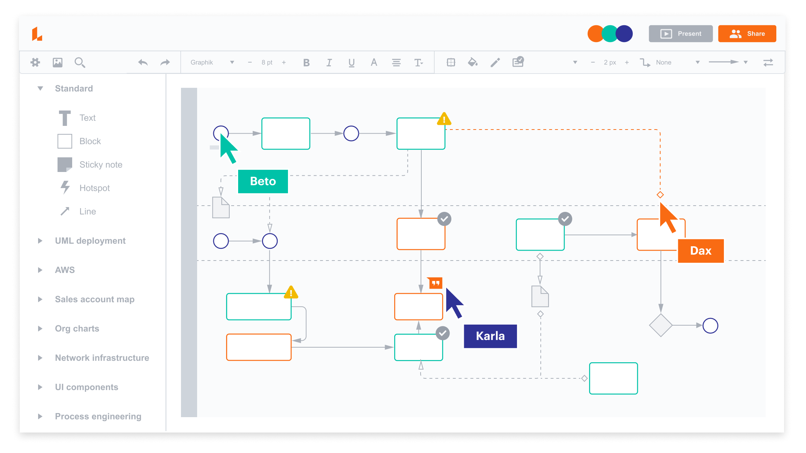
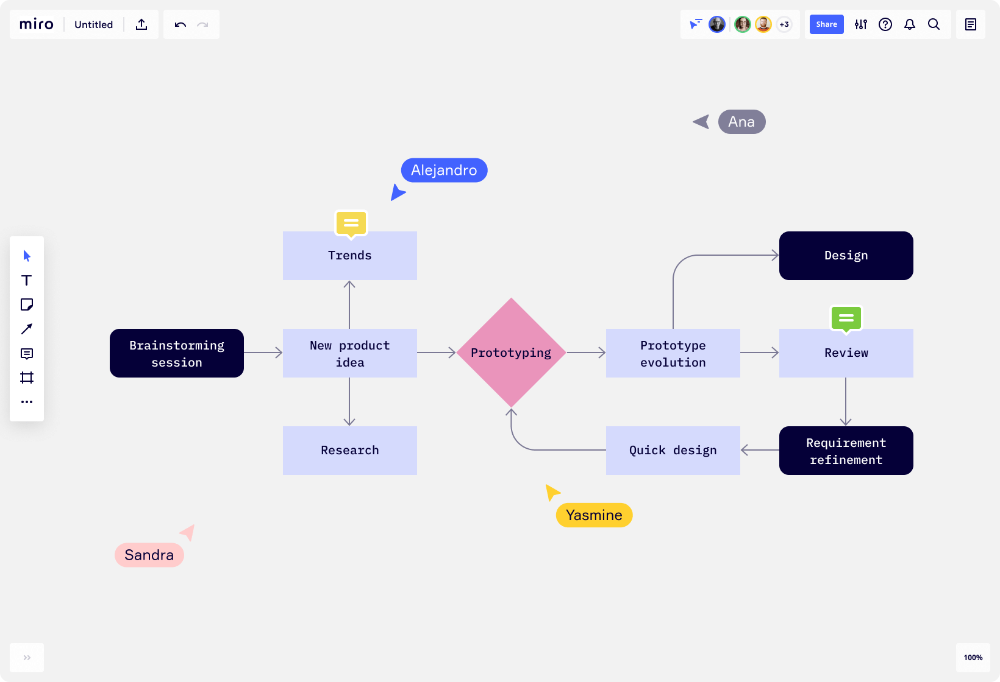
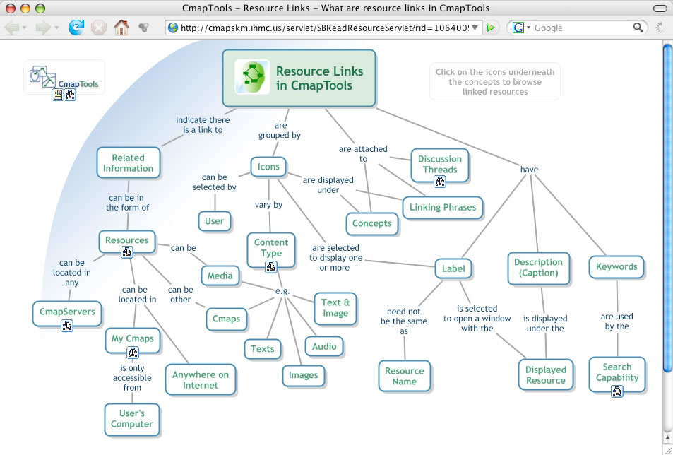

No importa en qué tramo de la carrera estés, desde el inicio aparecerá alguna actividad donde se pida diseñar un mapa conceptual.

Los **Mapas Conceptuales**, según Novak (2002) son **herramientas gráficas para la organización y representación de conocimientos o conceptos clave, en forma gráfica o pictórica**. La noción de “mapear conceptos” permite a los estudiantes lograr identificar relaciones entre ideas aparentemente aisladas, mientras desarrollan una estructura de conocimiento cohesiva. De esta forma, se fomenta un aprendizaje en profundidad, en lugar de memorizar. Así, el sujeto comprende el concepto global en lugar de hechos aislados.

En la misma línea, construir un Mapa Conceptual **requiere la recopilación de información adecuada y relevante, para su posterior secuenciación de forma jerárquica**. Por lo que, diseñarlos correctamente, **conlleva comprender el nivel de importancia** de cada idea dentro del contexto general. Y, finalmente, **resulta en una mejor retención de las nociones tratadas** en el mismo, a largo plazo. Es la jerarquía y el proceso cognitivo que supone su realización, lo que diferencia al Mapa Conceptual de otras formas de representación gráficas que, visualmente, son similares. Por ejemplo, mapas mentales, cuadros sinópticos, diagramas de flujo, etc.

Para **profundizar en esta temática**, recomiendo leer el artículo [**El mapa conceptual: una herramienta para aprender y enseñar**](https://www.medigraphic.com/cgi-bin/new/resumen.cgi?IDARTICULO=9331), por Manuel Francisco Aguilar Tamayo, publicado en la revista Plasticidad y Restauración Neurológica de 2006. En el mismo, no solo se presenta de forma general conceptos teóricos y metodológicos sobre los mapas conceptuales, sino también cuestiones técnicas para su posterior elaboración.

## Plataformas disponibles para diseñar Mapas Conceptuales

### LucidChart

[LucidChart](https://lucid.co/es/diagrama/mapa-conceptual) es una **plataforma basada en la nube** (online) que funciona como espacio de trabajo y diseño multipropósito. Permite la **creación de mapas mentales, organigramas, diagramas de flujo, cuadros, diagramas de tareas**, etc.

Al estar basada en la nube, admite la colaboración simultanea y el almacenamiento de información directamente en la cuenta del usuario, tal como sucede con las herramientas de la suite de Google o Microsoft. Asimismo, permite descargar, y en caso de necesitarlo hasta imprimir, cualquier producción en tres formatos distintos: JPEG, IMG y PDF. Además, posibilita la publicación directa a otros sitios, compartir vía correo electrónico o link de acceso directo. Como si no fuera poco, incluye la posibilidad de utilizar imágenes o figuras para complementar el diseño del proyecto que se esté realizando, además de poder anexar los propios mediante la carga de archivos. En la misma línea, concede permisos al usuario para customizar herramientas, objetos, integrar aplicaciones de terceros, etc.

Para finalizar, tiene tres tipos de cuenta para usuarios: cuenta gratuita, por subscripción, y por organización educativa (la cual requiere registro y verificación del dominio educativo).

### Miro

[Miro](https://miro.com/es/) es la **plataforma de pizarra colaborativa en línea** que permite que los equipos distribuidos trabajen juntos de manera efectiva, desde la lluvia de ideas con notas adhesivas digitales hasta la planificación y gestión de flujos de trabajo ágiles.

Si te gustaría saber cómo utilizar la plataforma de Miro y sus herramientas, [te comparto una guía al respecto](https://edutic.up.edu.pe/docs/guia_miro.pdf), confeccionada por la Universidad del Pacífico.

### CmapTools

Uno de los programas más conocidos en esta área es [CmapTools](https://cmap.ihmc.us/cmaptools/), herramienta para la creación de mapas conceptuales de manera fácil, sin complicaciones. Es un programa gratuito para computadora con sistemas Windows, OS X o Linux, siendo el sitio oficial quien ofrece el instalador del mismo.

De uso masivo, permite compartir las producciones en la comunidad, además de automáticamente crear versiones web de los mapas conceptuales diseñados, editarlos en simultaneo con otros usuarios, anexar imágenes, customizar formatos y colores, exportar en formato de imagen, PDF, web, entre otros.

Si existen dudas sobre las funciones que presenta este programa o precisas más información, el Gobierno de la Ciudad de Buenos Aires ha publicado un [documento tutorial](https://web.archive.org/web/20260324235304/https://biblioteca-digital.bue.edu.ar/descargar/282962-tutorial-cmaptools.pdf), dentro del Plan Integral de Educación Digital, Colección de aplicaciones gratuitas para contextos educativos.

## Referencias

Aguilar Tamayo, E. F. (2006). El mapa conceptual: una herramienta para aprender y enseñar. *Plasticidad y Restauración Neurológica, 5*(1), 7-17.

Novak, J. D. (2002). Meaningful learning: The essential factor for conceptual change in limited or inappropriate propositional hierarchies leading to empowerment of learners. *Science education, 86*(4), 548-571. [https://onlinelibrary.wiley.com/doi/abs/10.1002/sce.10032](https://onlinelibrary.wiley.com/doi/abs/10.1002/sce.10032)

Novak, J. D. y Cañas, A. J. (2006). *The Theory Underlying Concept Maps and How to Construct Them*. Florida Institute for Human and Machine Cognition. [https://cmap.ihmc.us/publications/researchpapers/theorycmaps/TheoryUnderlyingConceptMaps.bck-11-01-06.htm](https://cmap.ihmc.us/publications/researchpapers/theorycmaps/TheoryUnderlyingConceptMaps.bck-11-01-06.htm)
