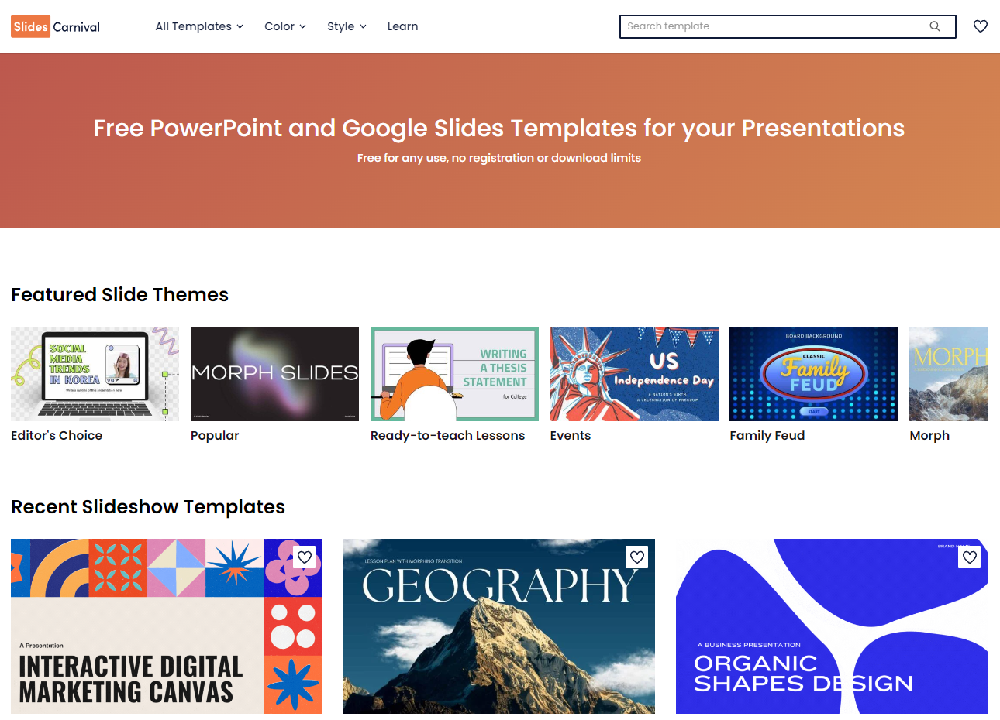

Al momento de estar armando una presentación, proyecto, trabajo práctico, videos o material educativo, los objetos multimedia son componentes vitales. Normalmente, el usuario común emplea los buscadores como Google o Bing para acceder a ellos de forma rápida, seleccionando lo que considere adecuado tras indagar por unos pocos minutos, sin detenerse a verificar si presenta algún tipo de copyright (normalmente, con una marca de agua).

Sin embargo, puede ocurrir que al emplear material con copyright, se produzca un inconveniente legal a futuro. Asimismo, como referentes debemos fomentar la utilización de material libre, además de profundizar la importancia del derecho de autor en todas sus formas. Afortunadamente, existe la opción de material gratuito disponible o a un precio razonable en la web.

A continuación, se mencionarán **recomendaciones antes de descargar material gratuito**, **además de algunas plataformas muy útiles**.

## Recomendaciones a considerar antes de descargar material gratuito

Al buscar y descargar una imagen o video, existen algunas restricciones que es preciso tener en cuenta.

Por un lado, **no todos los archivos** que descargas gratuitamente **pueden ser empleados con fines comerciales**. Por ejemplo, si estas desarrollando una obra que será publicada para su venta al público, tendrás que contratar un diseñador encargado del apartado artístico que necesite el producto.

Por otro lado, es posible que las imágenes descargadas puedan ser utilizadas pero **sea requerido la acreditación del autor**. En la misma línea, es conveniente **consultar la posibilidad de hacer modificaciones** sobre el contenido gratuito obtenido.

Todo esto lleva entonces a preguntarse: ***¿Cómo puedo saber qué material multimedia seleccionar?***

Es aquí donde aparecen los **diferentes tipos de licencia Creative Commons**. Implementar esta licencia y sus variantes no significa que no se aplique el copyright. Sino, la existencia de algunos derechos a otras personas bajo cuatro condiciones.

:::media

En primer lugar, la **Atribución** (*Attribution*). Esto refiere a que cualquier explotación, de la obra autorizada bajo esta licencia, precisará reconocer la autoría original (obligatoria en todos los casos posibles).
:::

:::media

En segundo lugar, **No Comercial** (*Non commercial*), la cual habla de la limitación, sobre la explotación de la obra, bajo uso no comercial.
:::

:::media

En tercer lugar, **Sin obras derivadas** (*No Derivate Works*), donde llevarlo a cabo precisa o no de autorización previa.
:::

:::media

Finalmente, **Compartir Igual** (*Share alike*). En este caso, la explotación autorizada de la obra original incluye la creación de obras derivadas. Sin embargo, debe mantenerse la misma licencia al ser publicadas.
:::

Para que sea fácil de comprender, se categorizan de la siguiente manera:

:::media

**Creative Commons Zero (CC0)**: En caso de que busques puramente material gratuito y de dominio público, esta es la correcta. No existirá restricción alguna.
:::

:::media

**CC Atribución (CC BY):** Se accede a cualquier tipo de modificación de la obra, incluyendo finalidades comerciales y la creación de obras derivadas. Además de la distribución, la cual no presenta restricción. Reconocida en la categoría de Licencia libre según la Freedom Defined.
:::

:::media

**CC Reconocimiento, Compartir Igual (CC BY-SA):** Autoriza el empleo comercial y las posibles obras derivadas. Respecto a esto último, la distribución debe mantener la licencia que regula la obra principal (es decir, tiene que ser exactamente la misma CC). Reconocida en la categoría de Licencia libre según la Freedom Defined.
:::

:::media

**CC Atribución, No Comercial (CC BY-NC):** Es posible generar obras derivadas sin fines comerciales únicamente. Este tipo de CC no es una licencia libre.
:::

:::media

**CC Atribución, No Comercial, Compartir Igual (CC-NC-SA):** Desautoriza tanto la utilización comercial de la obra original, como las derivadas. Además, es obligatoria la aplicación de una licencia igual a la regulada por la obra principal. Este tipo de CC no es una licencia libre.
:::

:::media

**CC Atribución, Sin Obra Derivada (BY-ND):** Está aprobada la utilización comercial de la obra, pero no la producción de obras derivadas. Este tipo de CC no es una licencia libre.
:::

:::media

**CC Atribución, No Comercial, Sin Obra Derivada (BY-NC-ND):** Inhabilita el empleo comercial de la obra principal y sus derivadas. Este tipo de CC no es una licencia libre y es símil al tradicional derecho de autor.
:::

Si estás interesado y deseas profundizar en el tema, puedes [acceder al sitio oficial de Creative Commons](https://creativecommons.org/share-your-work/).

## Pixabay

[**Pixabay**](https://pixabay.com/es/) es un sitio que permite descargar imágenes gratuitas, teniendo un stock de más de 1,7 millones de archivos disponibles. Una de las características que lo destacan es que todas las imágenes vienen con una de licencia Creative Commons Zero (CC0), permitiendo así utilizarlas tanto personal como profesionalmente sin infringir ningún derecho de autor.

*Página principal del sitio web Pixabay*

En conjunto con las imágenes, la página también ofrece gráficos vectoriales, ilustraciones y videos. Igualmente, la mayor parte del material ofrecido es de alta calidad. En algunos casos, hasta es posible elegir la resolución de acuerdo a la necesidad.

## Freepik (ahora Magnific)

Desde abril de 2026, Freepik se llama [**Magnific**](https://www.magnific.com/es) y sumó herramientas de IA, pero la biblioteca de recursos sigue estando. Siendo una empresa tecnológica española, Freepik Company se dedica a la **producción y posterior distribución de todo tipo de recurso gráfico, tanto gratuito como pago**. Asimismo, está complementado por Flaticon y Slidesgo, divisiones dedicadas también al mismo rubro, pero orientadas a íconos y *templates* para presentaciones multimedia. Además, ofrece varios idiomas para poder utilizar la plataforma sin restricciones.

*Página principal del sitio web Freepik*

El formato de los recursos varían entre fotografía, imágenes vectoriales, archivos de edición de Photoshop e íconos. Por tanto, el formato de descarga también lo hará, dependiendo lo que se necesite.

La descarga gratuita se encuentra limitada a tres archivos. En tanto que, con cuenta gratuita, el máximo por día es de diez objetos. Aunque, claramente, esa restricción se elimina en el caso de una subscripción.

El único **punto de dificultad**, que es preciso destacar, está dado en la necesidad de contar con cierto nivel de conocimiento para la modificación de los archivos sean en formato .png, .jpeg, .psd, .ui, .ai, entre otros. (estos tres últimos ligados a Adobe Photoshop e Illustrator respectivamente, aunque existen aplicaciones libres en la web para ejecutarlos).

## Flaticon

Tal como Freepik (hoy Magnific), [**Flaticon**](https://www.flaticon.es/) es una plataforma perteneciente a la misma compañía, compuesta por una **extensa librería de íconos de todo tipo de géneros y características**. Asimismo, su interfase gráfica hace fácil y rápido su uso, lo que ahorra tiempo al buscar el ícono y estilo adecuado para el proyecto que se esté desarrollando.

*Página principal del sitio web Flaticon*

El sitio web cuenta con una versión gratuita sin una cuenta, donde la descarga máxima está limitada a 10 descargas. En caso de crearse un usuario gratuito, el tope máximo aumenta a 50 objetos. Aunque toda restricción desaparece al acceder a una subscripción, tal como el caso anterior.

::video{id="x426QPTn-Ik"}

Entre sus **puntos positivos** se destaca el **formato de los archivos** (siendo los más utilizados .svg y .png, aunque también .eps, .psd y Base 64). Además, la utilización de un **editor integrado online** para personalizar los íconos previa la descarga, en conjunto con un **generador de patrones**. En la misma línea, poder implementar la [**extensión para G-Suite**](https://gsuite.google.com/marketplace/app/icons_for_slides_docs/381578326502?hl=es), facilitando el uso de los recursos directamente dentro de los archivos del paquete Google. Y, la posibilidad de acceder a la **descarga directa de paquetes de íconos**, en caso de querer mantener el estilo de diseño.

## Slidesgo

Es uno de los sitios referentes para la **creación, personalización y descarga de presentaciones**, al ofrecer integración entre archivos de [**Google Slides**](https://www.google.com/intl/es-419/slides/about/) y [**Microsoft PowerPoint**](https://www.microsoft.com/es-es/microsoft-365/powerpoint). Pero, eso no es todo. Además, [**Slidesgo](https://slidesgo.com/es/) integra infografías y otras plantillas** de diversos géneros, sea educación, negocios, marketing, etc.

*Página principal del sitio web Slidesgo*

Al igual que los anteriores, **permite acceder a los recursos** de forma libre sin cuenta, con usuario gratis o subscripción paga. En síntesis, es una buena opción si se quiere cambiar el formato predefinido que ofrecen los programas de autor. Además de ser un complemento a Freepik y Flaticon.

:::callout{tipo="idea"}

Otra alternativa con la misma finalidad es [Slides Carnival](https://www.slidescarnival.com/).

:::

::recurso{#slidescarnival}

