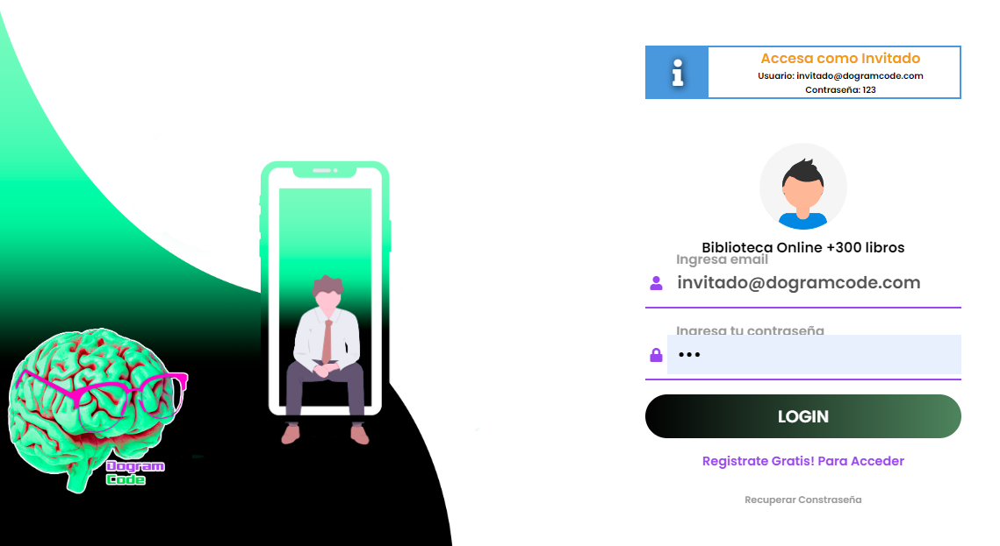
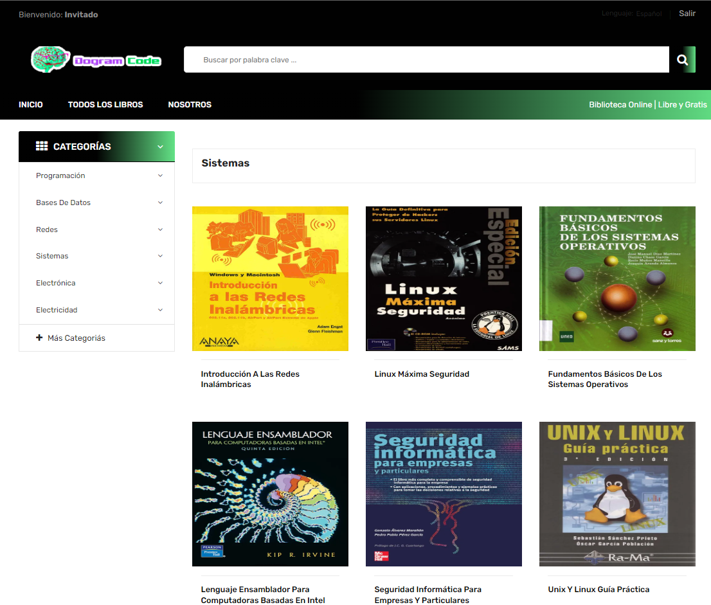

**La informática es un ámbito en constante cambio**. Todo material que se publique al día de hoy, estará *outdated* en pocos años. Al momento de buscar adquirir conocimiento y herramientas para profesionalizarnos, en conjunto con los cursos están los libros, manuales, apps y demás. Por ello, a continuación, **comparto recursos variados tanto en inglés como español**, la mayoría de ellos gratuitos pero también algunos pagos.

:::callout{tipo="tip"}

***Si estás buscando sobre una temática en específico, verificá la Home del Server. Es probable que haya creado un posteo dedicado.***

:::

:::callout{tipo="idea"}

**Aclaraciones**

- Todos los links pertenecen a third-party websites. Solo comparto material. Siempre que puedan, compren los libros y manuales, ayudan a los creadores originales y a ustedes a futuro.
- Si comparto las playlists es por recomendación del contenido. También chusmear los canales de YouTube de los creadores para encontrar más opciones.

:::

## Repositorio de manuales y herramientas

:::callout{tipo="idea"}

**Dogram Code** es una **free website que** "**busca compartir conocimiento mediante todo tipo de medios y herramientas**, sean libros, artículos y tutoriales orientados a la informática, sistemas computacionales y electrónica".

::recurso{#dogram-code}

:::

:::callout{tipo="tip"}

Paso 1. Para acceder a su biblioteca, hay que iniciar sesión con las credenciales que especifican en el sitio.

:::

:::callout{tipo="tip"}

Paso 2. Una vez dentro, el sitio cuenta con varios apartados importantes. Entre ellos, se encuentran: programación para principiantes, una BD recopilatoria de libros organizados según categoría, una sección orientada a qué estudiar, artículos, cursos, software, etc.

:::

:::callout{tipo="idea"}

**RecursosRecursosRecursos** básicamente es un **repositorio de recursos tech** (desarrollo web, cursos, GIT, guías, materiales para ilustración, desarrollo en JS, tools, etc.)

::recurso{#recursosrecursosrecursos}

:::

:::callout{tipo="idea"}

El **Profe Matías García**, dedicado al área de software y programación cuenta en su **sitio web con tutoriales y ejercicios variados para aprender**. Entre los temas disponibles hay sobre: **Algoritmos, Técnicas Digitales, lenguaje C & C++, JAVA, C#, LISP, Laravel, SQL, Sistemas Operativos, Redes de datos, Análisis y Diseño de Sistemas, Software Libre, Robótica & Arduino, Ofimática** (Hojas de Cálculo, Procesadores de Textos).

::recurso{#profe-matias-garcia-tutoriales}

::recurso{#profe-matias-garcia-youtube}

:::

:::callout{tipo="idea"}

**Librotecarios** es un **blog recopilatorio de links de acceso a libros y manuales** de varios géneros en archivos PDF.

::recurso{#librotecarios-coleccion-users}

::recurso{#red-users-drive}

:::

:::callout{tipo="idea"}

**Library Genesis** es una comunidad que **tiene como objetivo recopilar y catalogar descripciones de archivos para la mayor parte de las direcciones científicas y técnicas, así como metadatos de archivos**. Asimismo, **contiene enlaces a recursos de terceros alojados por los usuarios**. Toda la información publicada en el sitio web se recopila de los recursos públicos de Internet y está destinada únicamente a fines informativos.

::recurso{#library-genesis}

:::

:::callout{tipo="idea"}

**DEVHINTS.IO**, creado por [**@rstacruz**](https://twitter.com/rstacruz), es una **colección de cheatsheets** de diversos **lenguajes orientados a desarrollo web**.

::recurso{#devhints}

:::

:::callout{tipo="idea"}

**Write the Docs** es una **comunidad global de personas que se preocupan por la documentación**. Cuentan con una comunidad de Slack, realizan conferencias en 3 continentes y reuniones locales.
**Tienen un posteo dedicado a guiar en el proceso de armado de documentación. Lo recomiendo!**

::recurso{#write-the-docs}

::recurso{#write-the-docs-guia}

:::

:::callout{tipo="idea"}

**Smashing Magazine** ofrece artículos fiables, útiles y prácticos para diseñadores y desarrolladores web.

::recurso{#smashing-magazine}

:::

---

## Cuentas recomendadas

:::callout{tipo="idea"}

**Mujeres en Tecnología [MeT]** es una **organización sin fines de lucro** que trabaja para **impulsar la inclusión y la diversidad en el ámbito tecnológico.** Su **objetivo** es c**rear un ecosistema tecnológico más equitativo e inclusivo**, donde las mujeres y las diversidades de género tengan las mismas oportunidades para participar, desarrollarse y liderar.

::recurso{#mujeres-en-tecnologia}

::recurso{#mujeres-en-tecnologia-instagram}

- [Hilo de @comunidadmet en X](https://twitter.com/comunidadmet)

:::

:::callout{tipo="idea"}

**Chicas en Tecnología** ([**@chicasentec**](https://twitter.com/chicasentec)) es una **organización de la sociedad civil sin fines de lucro argentina** que **busca motivar, formar y acompañar a todas las mujeres** que quieran involucrarse en el mundo tecnológico. Cuentan con varios programas e iniciativas para participar.

::recurso{#chicas-en-tecnologia}

::recurso{#chicas-en-tecnologia-instagram}

:::

:::callout{tipo="idea"}

**Cristina López** es creadora de contenido en LinkedIn, dedicada al Desarrollo Web Front-End, Diseño UX/UI, HTML5 - CSS3, Figma.

::recurso{#cristina-lopez-design-thinking}

:::

:::callout{tipo="idea"}

**Los Apuntes de Majo** es un repositorio de apuntes hechos por Majo Ledesma con
Actualmente, entre las temáticas tratadas estan: JS, React, React Hooks, Python, CSS, POO con Python, SQL, GIT. **Se actualizan, así que recomiendo guardarlo y visitar el sitio.
>>** [Ir al Twitter de Majo](https://twitter.com/majoledes)

::recurso{#apuntes-de-majo}

::recurso{#majo-ledesma-github}

:::

:::callout{tipo="idea"}

**Lupita Code** ([@lupitacode](https://twitter.com/lupitacode)**)** es **desarrolladora Frontend** que comparte en sus redes sociales contenido sobre **JS, HTML, CSS code notes**.

::recurso{#lupita-code-youtube}

::recurso{#lupita-code-medium}

:::

:::callout{tipo="idea"}

**Gonzalo Pozzo ([@goncy)](https://twitter.com/goncy?s=20)** es un **desarrollador frontend** que comparte contenido vía Twitter, Twitch y YouTube sobre **React / Redux, pero también GraphQL, Elm o Vue**. Es Licenciado en Diseño Multimedia de la Escuela Da Vinci.

::recurso{#goncy-twitch}

::recurso{#goncy-youtube}

:::
